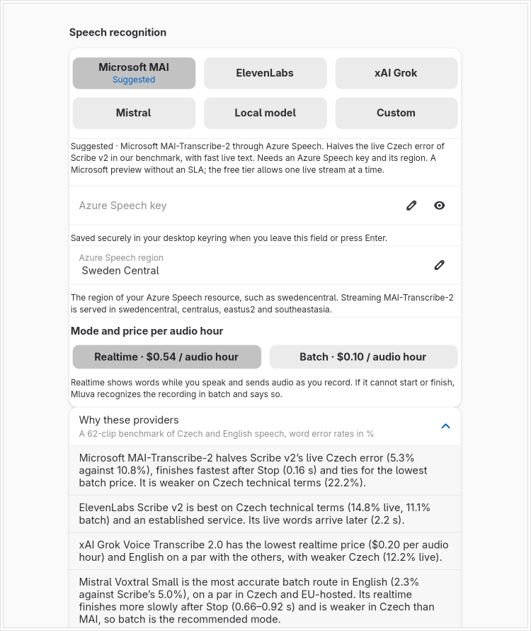

# Cloud speech providers: Microsoft MAI, xAI Grok and Mistral Voxtral

Evidence for the realtime/batch routes added beside ElevenLabs Scribe. See [Choosing a speech provider](../../provider-selection.md) for behavior, prices and the benchmark. All of it ran on 2 November 2026 on the maintainer's Omarchy PC. The routes stay Experimental until physical acceptance.

## What is checked, and how

| Layer | Check | Result |
| --- | --- | --- |
| Wire protocols | `cargo test -p mluva-providers --test microsoft --test xai --test mistral` against local HTTP and WebSocket peers: request framing and headers, multipart field order (`file` last), segment/delta handling, the xAI final segment that arrives twice, Azure `EndOfDictation`/`turn.end`, Voxtral's final message, errors, empty results, rate limits | 36 tests pass |
| Credentials | `cargo test -p mluva-providers --test cloud_credentials` through a synthetic `secret-tool`: one keyring entry and one cache per provider, environment alias order, exact store arguments | 6 tests pass |
| Whole capture session | `cargo test -p mluva-workflows --test cloud_routes`: phone audio through a real `CaptureSession` for each provider in realtime, with a failed stream, with a refused stream and in batch mode, checking History route, fallback reason, status text and diagnostics | 4 tests pass |
| Settings and History | `cargo test -p mluva-core --test cloud_providers` and the frozen `reference_contracts` | 7 and 8 tests pass |
| Provider page | `make linux-provider-settings-test` and `make linux-settings-test` (420, 736 and 1060 px) in the private offscreen runner | pass |
| Live services | `cargo run -p mluva-providers --example cloud_probe -- <provider> <mode> <clip.wav> <language>` once per route and clip | below |

## Live check

Public clips only (Google FLEURS Czech and English, CC BY 4.0, plus one synthetic Czech technical sentence), each route called once per clip, one request at a time, 18 runs and no failures. "First text" is measured from the first audio chunk, "after stop" from the last. Texts are what the app would commit; the references are the clips' transcripts.

| Provider | Mode | Czech (reference: *Schengenský prostor nicméně v tomto ohledu funguje podobně jako jedna země.*) | English (reference: *The governor's office said nineteen of the injured were police officers.*) |
| --- | --- | --- | --- |
| Microsoft MAI | batch, 1.5 s | Schengenský prostor nicméně v tomto ohledu funguje podobně jako jedna zem- země. | The governor's office said 19 of the injured were police officers. |
| Microsoft MAI | realtime, first text 1.0 s, 0.93 s after stop | same as batch | The governor's office said 19 of the injured were police officers. (first text 1.1 s, 0.13 s after stop) |
| xAI Grok | batch, 0.6 s | Žingenský prostor, nicméně v tomto ohledu, funguje podobně jako jedna země. | The Governor's Office and 19 of the injured were police officers. |
| xAI Grok | realtime, first text 1.2 s, 0.23 s after stop | Šingenský prostor, nicméně v tomto ohledu, funguje podobně jako jedna ze země. | The governor's office and nineteen of the injured were police officers. (first text 1.1 s, 0.20 s after stop) |
| Mistral Voxtral | batch, 0.6 s | Schengenský prostor nicméně v tomto ohledu funguje podobně jako jedna země. | The governor's office said 19 of the injured were police officers. |
| Mistral Voxtral | realtime, first text 2.5 s, 0.68 s after stop | same as batch | The Governor's Office and 19 of the Injured Work Police Officers. (first text 1.7 s, 0.67 s after stop) |

The synthetic sentence *Otevři pull request a přidej Honzu jako reviewera.* came back as *Otevřej pull request a přidaj Honzu jako reviewera.* from MAI (both modes) and exactly from xAI and Mistral (both modes), matching the benchmark's finding that MAI is weaker on Czech technical terms. Single clips show timing and behavior, not accuracy; the benchmark in the provider guide covers 62 clips.

## Provider page

The Providers page in a 760 px private window with the Azure choice, a typed region (stored as `swedencentral`), the price-labelled mode and the expanded "Why these providers" section. The six choices wrap in lines of three so they fit the 420 px minimum.

## Not verified

- No physical microphone, real desktop paste or live Hyprland session: capture used phone-sourced synthetic PCM, and the GUI ran offscreen.
- The macOS app dictates with ElevenLabs only. It mirrors the two new settings so saving keeps them, but its Swift code was not built or run here.
- The Azure free tier allows one live stream at a time, and Mistral's entry tier returns HTTP 429 on bursts. Both limits are reported by the app; neither was provoked against the live services, so those messages are checked against local peers only.
- Hosted CI is on demand and was not run.
