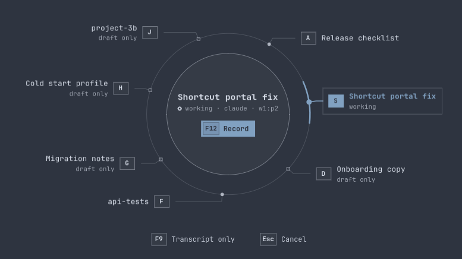
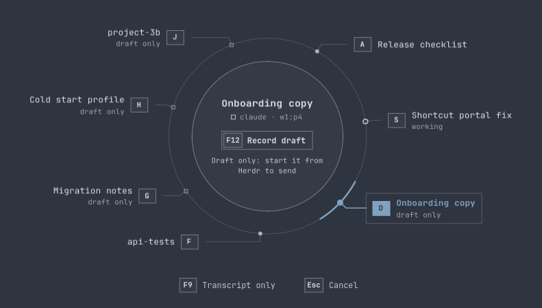
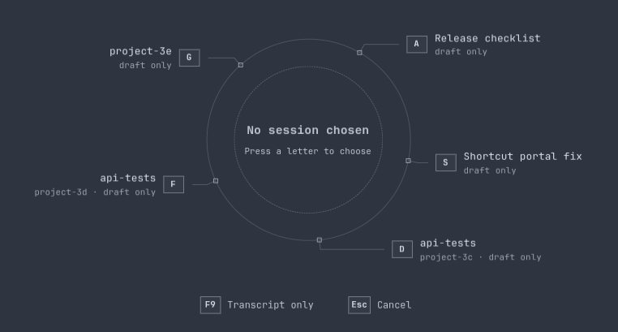
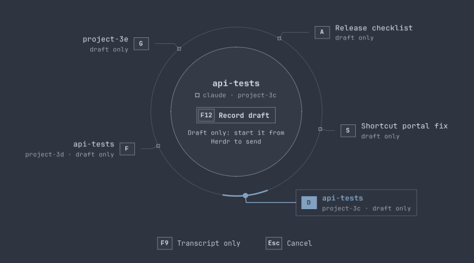
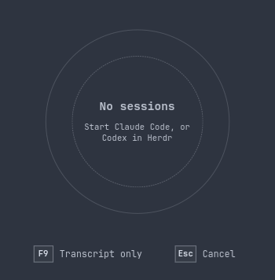

# Session discovery acceptance

The agent key's session wheel now lists every running Claude Code session, not only the ones Herdr can send to. Discovery comes from Claude Code's own session registry, so it works without Herdr; Herdr adds pane order and the guarded send transport.

## The defect

Mluva asked Herdr only for `agent.guarded_list`. Herdr's guarded-prompt integration guards a Claude Code session only when Herdr launched it itself (its new-agent tab or `herdr agent start`). Sessions started by typing `claude` in a pane, or restarted after Herdr launched them, appear in Herdr's `agent.list` but never in `agent.guarded_list`, so the wheel dropped them. A read-only comparison against a live Herdr server found 10 Claude Code agents in `agent.list` and 7 in `agent.guarded_list`; the 3 missing were exactly the unmanaged ones.

A second defect affected names: Claude Code titles the terminal with the agent type for sessions started with `--agent`, so several sessions could all show the same agent-type name.

## Behaviour now

- **Herdr agents**, in Herdr's pane order: every agent in `agent.list`. Guarded agents keep their guard and can be sent to; the rest are shown without a transport.
- **Claude Code sessions outside Herdr**, after them in the order they started, from `sessions/<pid>.json` in Claude Code's configuration directory. Entries are admitted only for live interactive processes whose recorded start time matches, in Mluva's PID namespace; `.key` files are never opened.
- **Names** for Claude Code: the person's own name for the session, then the latest custom title, then the latest generated title from the transcript, matched by session ID; then Herdr's label; then the terminal title unless it is only the agent type; then Claude Code's generated handle.
- **Draft only**: a session without Herdr's guarded transport can be chosen. The wheel marks it with a square and **draft only**, and the centre offers **Record draft** with "Draft only: start it from Herdr to send". The second agent key records into Mluva's editable document, with no copy, paste or send; the next press stops it.

| Herdr guarded, unmanaged and registry-only sessions together | An unmanaged Herdr session chosen |
| --- | --- |
|  |  |

| Herdr absent: registry sessions only | A registry-only session chosen | No sessions |
| --- | --- | --- |
|  |  |  |

The captures are the production wheel from the `session_wheel_gallery` example, in the window fallback at 1920×1200 on a private Xvfb display with a private session bus and accessibility registry. Every name, pane, process and session ID is a fixture.

## Evidence

| Boundary | Evidence |
| --- | --- |
| Regression | `herdr::tests::an_unmanaged_claude_session_herdr_lists_but_does_not_guard_is_still_discovered` uses a fake Herdr peer whose `agent.guarded_list` omits a typed Claude Code pane that `agent.list` reports. On the parent commit it fails: discovery returned only the two guarded agents. It passes now: the pane is offered in Herdr's order, cannot receive, and a submission to it is rejected without connecting. |
| Registry | `claude_sessions` tests use a synthetic registry in a temporary directory. They admit a live entry (the test's own process and real start time) and reject an exited process, a reused PID, a background session, a spare, another PID namespace, a symlinked entry, a symlinked or shared directory and Mluva's own process tree. A `.key` FIFO with a waiting writer proves the key file is never opened. Unknown fields and values are ignored, and an entry caught mid-rewrite keeps its last whole reading while the same process lives. |
| Names | Transcript tails take the latest `custom-title`, `ai-title` and `agent-setting` records, skip title-shaped objects inside messages, wait for a half-written line, and read a transcript larger than 1 MiB from its end. The merge test covers Herdr order first, enrichment by session ID, registry-only sessions after, and the full name order. |
| Identity | Core tests: a session without a guard matches by session ID and process, so the same session seen with or without Herdr stays chosen, while a resumed process or a new session in the same pane does not. Guarded identities are unchanged and never match an unguarded one. Settings saved before this change load unchanged. |
| Real application | `bash linux/tests/run_application_smoke.sh agent-voice` passed: 13 captures, 11 recognitions, four guarded submissions. A synthetic Claude Code registry and transcript name a guarded Herdr pane by session ID. An unmanaged Herdr pane and a registry-only session, backed by a synthetic process outside the app's process tree, are offered after the guarded panes. Choosing the registry-only one, the second F12 records a transcript and the next F12 stops it: the transcript is in the editor, nothing was sent, the clipboard is unchanged. With Herdr's list emptied, the registry session remains on its own as draft-only. No GTK critical warnings were logged; the four known narrow-editor allocation warnings remain. |
| Routing CLI | `dev/verify.sh session … linux/tests/support/herdr_cli.sh` passed with the production process: list, status, select, ambiguity and blocked rejection, restart and Incognito. The peer saw only `agent.guarded_list` and `agent.list` (17 each) and no prompt. `mluva herdr select` still accepts only sessions Mluva can send to. |
| Shortcut portal | `make linux-shortcut-test` passed. |

These checks ran in a disposable X11 desktop with private HOME/XDG, D-Bus, accessibility, clipboard, audio fixtures and loopback providers. They do not establish physical F12 input, the live Wayland overlay, or a real Herdr server and Claude Code process.
