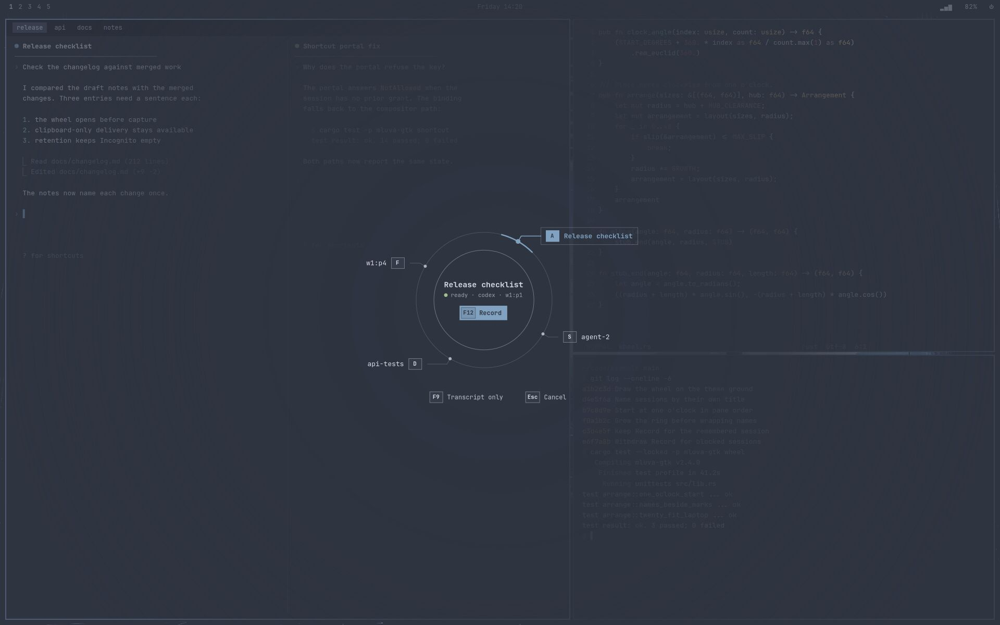
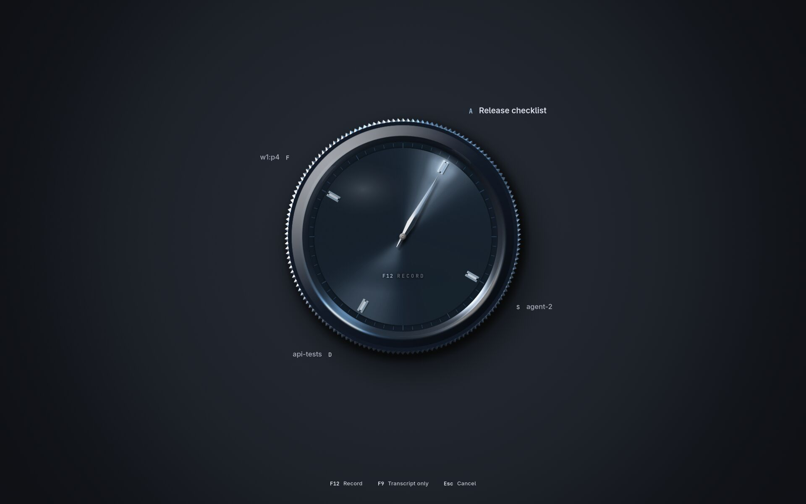
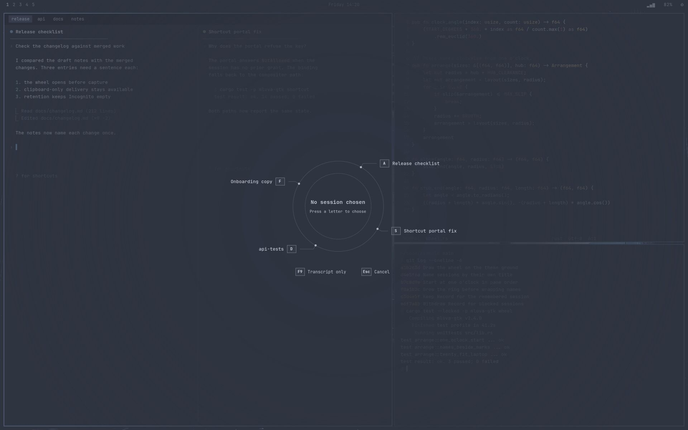
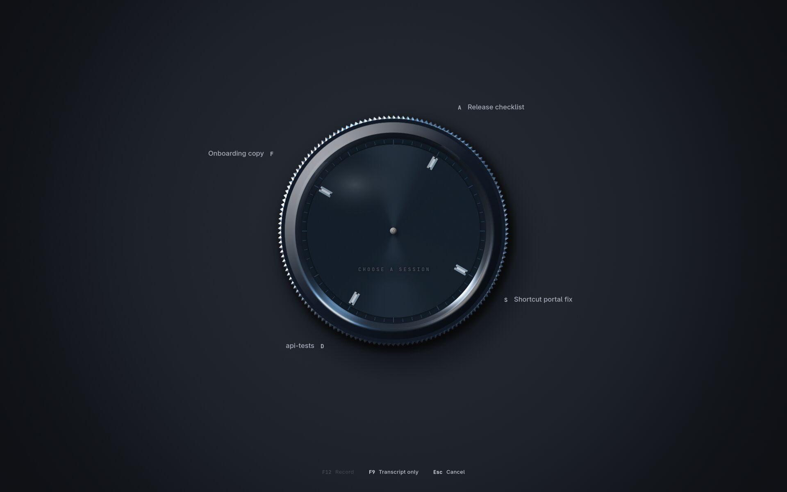
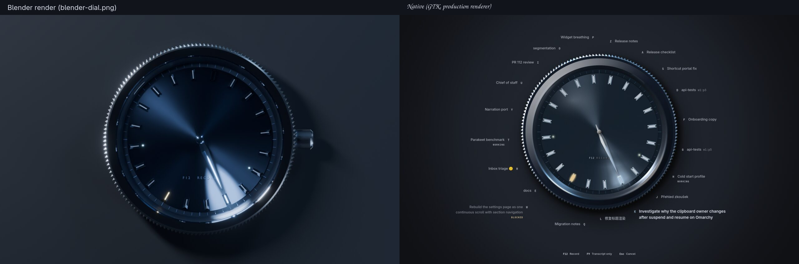

# Session wheel acceptance

The configured agent shortcut opens a session wheel before capture. With F12 configured, the first press only displays the wheel and selects. The second press starts capture for the remembered guarded recipient, and a later press stops it through the existing cancellation and delivery flow. The product default remains F8.

## Names

Each session is named by its agent's own title, shown whole:

- **Claude Code:** the custom or generated session title Claude Code puts in the terminal title, with its activity glyph stripped by Herdr. A brand-new session titled only "Claude Code" has no name yet.
- **Codex:** the thread name in Codex's own `session_index.jsonl`, matched to the session ID Herdr reports for that pane. The latest entry wins, so renames show at once.

Codex's terminal title is not parsed: its layout is configurable, and before a thread is named it shows only the project (`project` in the real-agent run below).

A session without a title shows its Herdr agent name, then its pane ID. This is a genuine fallback, not a parse failure. Mluva never renames a session and never shortens a title to fit; only metadata beyond 240 characters is bounded. Herdr's agent name stays the routing handle for `mluva herdr select`, and `mluva herdr list` reports `title` beside it. The previous wheel showed Herdr's agent name, which for dispatched agents is a handle such as `cos` or `linear-…`, and cut names to two lines with an ellipsis.

## Overlay

On Omarchy the wheel floats over the desktop like Omarchy's own launcher, with no window, frame or card. It is a wlr-layer-shell overlay that covers the focused monitor, panels included, and takes the keyboard while it is shown.

The room is one opaque ground in the theme's canvas, darkened a little, with a faint lift around the watch and a soft vignette at the edges. It is smooth: the ground, the vignette and the case's large soft shadow to the lower right are computed in floating point once per size and scale and quantised once with triangular dither, so no ring shows even under a contrast stretch ([before and after](stretch-room-before-after.png)); the dial is tinted and dithered the same way ([before and after](stretch-dial-before-after.png)), and nothing on the desktop shows through behind a name. Mluva's managed Hyprland Lua also gives the `mluva-session-wheel` namespace a `no_anim` layer rule, as Omarchy does for its own menus, so the wheel appears with no compositor fade of its own; the watch then fades in over at most 160 ms. The rule is kept as one handle across reloads: a live rule is reused, a switched-off one is switched on and a rule the compositor dropped is made again, so reloads never stack duplicates. It runs under `pcall` after the bindings, so a Hyprland without layer rules, or any error in the rule, never stops the bindings from applying. Clicking anywhere outside a control dismisses the overlay, like Escape.

On X11, or on compositors without layer-shell, the same wheel opens as an ordinary frameless dialog on the same ground. The offscreen tests use that path.

The overlay links `gtk4-layer-shell`, which is part of Omarchy's base install. It is linked rather than loaded later because it must load before `libwayland-client`. Setup and CI now request it.

## The watch

The wheel is a watch, so the chosen session is where the light falls. The static parts are Blender renders baked into layers (see `rust/mluva-gtk/resources/wheel/README.md`) and composited live with GtkSnapshot:

- **Case.** A knurled steel case with real teeth and a baked contact shadow, 1.247 times the dial's radius, with a neutral steel bevel sheen on its band lit from the upper left.
- **Dial.** A sunray dial stored as luminance and tinted at runtime from the theme's accent and darker ground, so Nord lands on the render's navy and the default palettes get their own tint. A chapter ring and a railway minute track are part of the bake.
- **Indices.** One chunky faceted applied index per session, picked from a 24-view atlas so its highlights stay fixed in screen space. The lume channel is a recess filled live: the accent mix for the chosen index, the warning colour for blocked, a dim ink otherwise, blooming on the chosen and blocked ones. The lume fills the recess flush, so each index reads as one baton, and the batons slim a little at twenty sessions. The chosen index is drawn above the light with full lume and bloom, so it is the brightest mark on the dial and the beam never fogs it. Working has a lume dot at 0.74 of the dial radius, draft-only uses the hollow atlas, and a gone session is an empty setting with two tiny feet.
- **Hub.** A small neutral polished-steel cap, 3.5% of the dial radius, drawn live: a thin bevelled rim bright at the upper left and dark at the lower right, a domed face with one soft highlight and a tiny dark pinion hole, with one blurred shadow to the lower right. The hand keeps only a short counterweight, 17% of its length, past it ([4× crop, before and after](hub-before-after.png)).
- **Hand and light.** A faceted hand whose lit and shaded facets trade places as it turns against a fixed upper-left light, with a shadow offset to the lower right and a glowing lume channel, under a polished cap. The hand is a damped spring with a small mechanical overshoot. The sunray sheen turns to the light on a softer spring, and a beam and a pool of light follow it, so the glow trails the hand and settles on the index. The light is the accent mixed toward the ink, and the warning colour for a blocked or missing choice.
- **Crystal.** A domed crystal over everything on the dial, its main reflection at the upper left with the light, and only a faint rim at the lower right.
- **Dial text.** `F12 RECORD`, 42% of the dial radius below the centre, or `BLOCKED`, `GONE` or `CHOOSE A SESSION`. The light dips gently under the printing along an elliptical falloff with no edge, and the text carries a soft dark halo, so it stays readable wherever the beam falls. The centre never repeats the chosen name. The legend at the bottom reads `F12 Record · F9 Transcript only · Esc Cancel`, and Record dims while it is withdrawn.

The case, tinted dial, indices, cap and crystal never move while the choice swings, so each is composited once into a layer, baked into a texture at the display's scale and merely appended each frame. Per frame only the sheen, the beam and pool, the lume bloom of the chosen index, the hand with its shadow and facet shading are drawn, which stays smooth on the cairo renderer the private desktop uses. Colour comes from the active theme's canvas, ink, action, warning and success tokens. The steel stays steel in every theme and only the dial's tint and the lume follow it. On open the hand sweeps in from about −40° and the watch fades in over 160 ms. With animations disabled everything is placed at rest.

## Layout

Sessions follow Herdr's order: workspace, tab, then pane layout, with left or top first. The first session, the leftmost pane, sits at one o'clock; the rest follow clockwise at even angles.

Every full name stands in the room on its own index's bearing:

- A name hangs off a point just beyond the case along its bearing: wholly to the right on the right, wholly to the left on the left, and above, below or centred toward the poles. It never touches the case.
- Names that would touch are pushed apart toward their pole, the one nearest three or nine o'clock keeping its place. There are no leader lines, boxes or key caps.
- The uppercase letter key faces the watch, then the name in the system sans (Adwaita Sans, then Inter). Keys and captions are JetBrains Mono. Names wrap only at spaces, or inside a single long token; they are never ellipsized.
- Pane IDs appear only for duplicate names. A small-caps caption (`working`, `blocked`, `draft only`, `gone`) appears only for those states.
- Names rest slightly dimmed. Hover and keyboard focus brighten the name, light its key and lift the lume of its index; nothing is boxed or ringed. The chosen name is larger and semibold with its key in the light's colour.

The dial grows with the count, from a small watch for one session to a large one for twenty, and shrinks, never the names, when the screen is smaller. Geometry depends only on the count and on the names: every name is measured in its chosen size with a caption line of fixed width, so a refresh that changes a status, or a new choice, moves nothing. A refresh in which no Herdr server answers is a failed read, not an empty list: while the wheel is open it keeps the sessions it shows and its page, and sending stays guarded.

Letters choose in clockwise order, home row first, and display uppercase: A S D F G H J K L, then Q W E R T Y U I O P, then Z X C V B N M. Typing either case chooses. Up to 26 sessions show together; Left/Right page beyond that, and Escape cancels. A click on an index chooses it and a click elsewhere on the dial records.

The first press of the agent key selects and the second records; a second press while a message waits in its cancellation window sends it now. A blocked or missing session stays chosen in the warning colour, and the dial withdraws Record instead of choosing a neighbour. A remembered session on another page stays chosen and the dial says which page.

Before and after, from the production renderer offscreen at 1920×1200 on the Nord reference theme. The before captures are the wheel at `c280d80`, composited over a synthetic desktop because its scrim was translucent. The after captures need no desktop, since the room is opaque.

| State | Before | After |
| --- | --- | --- |
| Twenty sessions, one long legacy name chosen |  |  |
| Six, with duplicates and a working session |  |  |
| One |  |  |
| Blocked choice |  |  |
| Remembered session missing |  |  |
| Untitled sessions fall back to Herdr name or pane |  |  |
| No selection |  |  |
| 30 sessions: 26 together, the remembered one on page 2 |  |  |
| Keyboard focus on a choice |  |  |
| Pointer hover on a choice (before: with the centre focused) |  |  |
| Default light palette |  |  |
| The hand swinging to a new choice (before: the arc 150 ms in; after: the hand about 60 ms in) |  |  |

More captures of the after state: [default dark palette, blocked choice](after-dark-blocked.jpg), [keyboard focus on Record](after-focus-record.jpg) and [twenty with the last session found outside Herdr](after-twenty-draft.jpg), the draft-only hollow index.

The window fallback on X11, at its natural size, with no frame:

| Twenty sessions (1437×1089) | Six sessions (1105×806) |
| --- | --- |
|  |  |

The Blender render of the watch and the native wheel at twenty sessions:



The native watch still differs from the render in these ways:

- The render is a lit 3D scene; the native watch composites its layers with a live sheen, beam and pool. The pool of light is less bright than the render's, and the render's reflections move with its camera while the crystal here is fixed.
- The render's crown is not in the layers.
- The baked contact shadow reaches the edge of the 2048 px frame, so it is faded out near the frame's edge and is tighter than the render's.
- Indices are the nearest of 24 baked views, turned by at most 7.5°, so a highlight can be a few degrees off a render's.
- The beam is a wedge of about 12° that fans toward the rim, a little fainter than the render's.
- The default light and dark palettes keep the steel and tint only the dial, so they differ from Nord's blue.
- Names are pushed apart and kept off the case by a deterministic rule where they crowd.

## Artifacts removed

Daniel confirmed eleven artifacts of the previous wheel; each is gone, and the captures above are the evidence.

| Artifact | Now |
| --- | --- |
| A1: desktop text ghosting behind names | The room is opaque; nothing behind it shows. |
| A2: banding in the scrim | One smooth ground, vignette and shadow computed in floating point and dithered once at 8 bit. |
| A3: the accent needle arc | A hand and a light, with no arc. |
| A4: a box around the chosen name | The chosen name is larger and semibold; nothing is boxed. |
| A5: leader lines from mark to name | None. Each name stands on its index's bearing. |
| A6: a box around every key | Keys are plain uppercase letters, in the light's colour when chosen. |
| A7: doubled focus rings around the centre | No rings. Keyboard focus brightens a name and lights its key, or brightens a legend entry. |
| A8: the centre repeating a long name | The dial prints the record key, or BLOCKED, GONE, CHOOSE A SESSION. |
| A9: boxes on hover | Hover brightens the name, lights its key and lifts its index's lume. |
| A10: a compositor fade with no `no_anim` rule | Mluva's managed Hyprland Lua adds the rule for `mluva-session-wheel`. |
| A11: geometry that moved with status captions | The gallery changes three statuses and the choice on twenty sessions and checks that no name moves. |

## Evidence

| Boundary | Evidence |
| --- | --- |
| Native gate | `make linux-test` with `TMPDIR` on disk passed: 240 passed, zero failed, 69 gated or ignored. Both strict Clippy configurations, formatting and generated-feature consistency passed. Geometry unit tests cover: the one o'clock start and clockwise angles; names on their own index's side; no overlap with each other or the case for 1–26 sessions and for 400 pseudo-random mixes of count and name size; every name inside a stage that fits the laptop screen; clockwise order per side; each name near its own index; the dial shrinking on a small screen while every name stays; and that the layout depends on the names alone. Spring tests cover the hand's small overshoot, the light trailing it and the short way round. The ignored Lua test, run with the system interpreter, covers the managed Hyprland script: one `no_anim` rule across applies, a switched-off rule re-enabled and a dropped one recreated, with other bindings untouched; a `layer_rule` that throws or is missing still leaves the bindings applied. |
| Name provenance | Provider tests use a Herdr peer and a Codex index fixture. They cover Claude titles, renamed Codex threads (latest wins), long and Unicode titles, the "Claude Code" product title, an unnamed Codex thread whose terminal title is only the project, and the fallback to Herdr name and pane. An index larger than 4 MiB is read from its newest whole lines. |
| Real application | `make linux-agent-voice-test` passed: 15 captures, 13 recognitions, five guarded submissions. Private X11 keys exercise selection, Escape, second F12, F9, paging at 30 sessions, server reorder and target disappearance, and the wheel fits the private screen from zero to 20 sessions. The wording of the notice a new recording gives when it interrupts a countdown is a unit test: History is promised only when a row exists. A refresh that cannot read Herdr while thirty sessions are paged to page 2 leaves the page and all thirty sessions in place; before the fix such a transient failure collapsed the wheel to the one remembered session and reset the page (the test failed 4 of 4 runs, and passed 3 of 3 after). The test's Herdr peer now skips a client that connects and goes quiet instead of exiting. The four known narrow-editor allocation warnings remain and none comes from the wheel. |
| Shortcut portal | `make linux-shortcut-test` passed. |
| End to end | `bash linux/tests/run_agent_end_to_end.sh /absolute/herdr` passed with production Mluva, private portal activation, synthetic PCM, an actual guarded Herdr server, actual Codex with loopback inference and actual Claude Code. First activation only displays the wheel; the next press starts capture, release keeps recording, and exactly one message receives an accepted receipt. Mluva's `herdr list` reported no title for the fresh Claude session (terminal title "Claude Code") or the unnamed Codex thread (terminal title "project"), so both fell back to their Herdr names. This run used the window path. |
| Live overlay (Hyprland 0.56.2) | With the developer's consent, a synthetic-session example opened the production wheel on the live desktop for a few seconds. `hyprctl layers` listed namespace `mluva-session-wheel` on the overlay layer of the focused monitor at its full 2560×1440 size. The developer confirmed it stayed for the whole run and looked right. A first attempt showed the window had kept its natural size; making the overlay resizable fixed that. `hyprctl layers` stopped listing the surface about 2–3 s into each run although it stayed visible; this remains unexplained. No screenshot of the desktop was taken, and the app's global F12 path was not exercised live. |
| Not verified live | The watch has not been shown on the live compositor: no live layer-shell run, no live F12 path and no check of the `no_anim` rule against the running Hyprland. The rule's Lua was run only against a stub of `hl` with the system Lua interpreter. The Lenovo's 3840×2400 screen at scale 2 was approximated by an offscreen 3840×2400 X11 screen at scale 2. Frame pacing on real hardware, GPU renderer behaviour and the Wayland layer-shell surface size are not measured. |
| Live metadata (read only) | One `agent.guarded_list` read against the developer's running Herdr: all six live Codex and Claude Code sessions resolved to the title held in their agent's own store. That is the Codex `thread_name` for the session ID, or Claude Code's effective `customTitle`/`aiTitle`; none showed a dispatch name. No names are recorded here. |
| Visual states | The `session_wheel_gallery` example renders the production wheel in 22 synthetic states per palette, at a chosen screen size, as a window or with `overlay` styling at screen size. The states are: one, three, six, 20 and 30 sessions; long, duplicate, Czech, CJK and emoji names; blocked, missing, draft-only and untitled sessions; no selection; empty; hover; keyboard focus on a choice, on Record and on Cancel; and the hand in flight and at rest. It also audits itself and exits with a failure if a name leaves the screen, two names overlap, or three status changes plus a new choice on twenty sessions move any name. |
| Visual review | Daniel picked the sundial-watch direction from ten prototypes and asked for it to be pushed further; then asked for it to look like the Blender render; the native build composites that render's baked layers and lists where it still differs. The captures in three palettes (Nord, default light and default dark) were reviewed against the eleven artifacts and the render. An independent impeccable finish review then scored the native watch against the render and asked for eight fixes: a brighter chosen index above the light, flush lume, a steel bevel on the case band, light kept at the upper left, readable dial text, visible hover, a feathered pool edge and a true mid-swing capture. All are applied in the captures above. |

Render the gallery inside the private desktop at the screen being judged:

```sh
cargo build --locked -p mluva-gtk --example session_wheel_gallery
OFFSCREEN_SCREEN_SPEC=1920x1200x24 bwrap --die-with-parent --bind / / --dev /dev --tmpfs /run/dbus -- \
  bash dev/run-isolated-browser.sh "$PWD/tmp/wheel-gallery" -- \
  "$CARGO_TARGET_DIR/debug/examples/session_wheel_gallery" nord "$PWD/tmp/wheel-gallery/png" overlay
```

Drop `overlay` for the window fallback. The gallery prints whether the layout was independent of status and choice and exits with a failure on any audit problem.

The [machine-readable result](results.json) contains only synthetic acceptance data; session names, panes and sockets are fixtures. Apart from the live overlay row, which describes the previous wheel, the checks ran in a disposable X11 desktop with private HOME/XDG, D-Bus, accessibility, clipboard, audio fixtures and loopback providers. They do not establish physical F12/F9 input, a real microphone or provider, or the full live Wayland journey.
