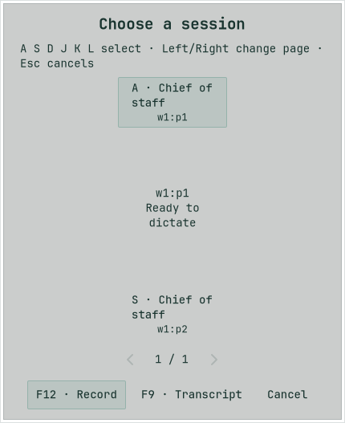
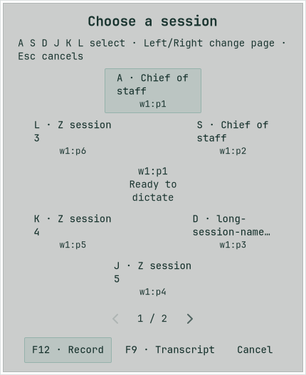

# Session wheel acceptance

The 20 October 2026 run verified the configured agent shortcut opening a session wheel before capture. With F12 configured, the first press selects only, the second starts capture for the remembered guarded recipient, and a later press stops it through the existing cancellation and delivery flow. The product default remains F8.

| Boundary | Evidence |
| --- | --- |
| Native gate | `make linux-test linux-shortcut-test`: 165 passed, zero failed, 68 gated/ignored; both strict Clippy configurations, formatting and generated-feature consistency passed. |
| Real application | `bash linux/tests/run_application_smoke.sh agent-voice`: 12 captures, 10 recognitions, four guarded submissions. Private X11 keys exercise selection, Escape, second F12, F9, paging, server reorder and target disappearance. Geometry checks cover zero through six choices and a long session name. |
| Alternate transcript | F12 → F9 retains editable text in Mluva, preserves raw recognition and autosaves edits, without automatic clipboard, paste or agent submission. This destination remains provisional; the no-direct-agent-send behavior is confirmed. |
| End to end | `bash linux/tests/run_agent_end_to_end.sh /absolute/herdr`: production Mluva, private portal activation, synthetic PCM, actual Herdr and actual Codex with loopback Responses inference. First activation opens only; held-key repeat cannot begin capture; the next press starts, release keeps recording and exactly one synthetic message receives an accepted receipt. |
| Build and lint | `make linux-setup`, strict GTK Clippy after the final scoped foreground correction, and repository ShellCheck passed. |
| Visual review | Minimum, narrow and wide parent-window captures retain the same bounded wheel; six-choice and long-name capture also reviewed. Final pane captions measure 8.35:1 unselected and 7.55:1 selected. |

The [machine-readable result](results.json) contains only synthetic acceptance data. These screenshots come from the final passing application run; the first three parent-window sizes produced the same 420×520 wheel client area. Session names and pane IDs are fixtures.

| Remembered recipient | Six choices in pane order |
| --- | --- |
|  |  |

The checks ran in a disposable X11 desktop with private HOME/XDG, D-Bus, accessibility, clipboard, audio fixtures and loopback providers. They do not establish physical F12/F9, real microphone/provider or live Wayland behavior. Normal opted-in account sharing remains governed by the existing capture policy. Later narrow-editor states emitted GTK allocation warnings; the suite and wheel geometry assertions passed, but the warnings remain in the retained log.

Raw logs, screenshots and private runner state remain under the worktree's `tmp/`: `wheel-native-gate-final.log`, `wheel-application-accepted.log`, `wheel-end-to-end-final.log`, `wheel-build-accepted.log` and `wheel-shellcheck.log`. Re-run the commands for fresh evidence. This feature was prepared as a draft; merge and installation are separate actions.
