# Session wheel acceptance

The configured agent shortcut opens a session wheel before capture. With F12 configured, the first press only displays the wheel and selects. The second press starts capture for the remembered guarded recipient, and a later press stops it through the existing cancellation and delivery flow. The product default remains F8.

## Names

Each session is named by its agent's own title, shown whole:

- **Claude Code:** the custom or generated session title Claude Code puts in the terminal title, with its activity glyph stripped by Herdr. A brand-new session titled only "Claude Code" has no name yet.
- **Codex:** the thread name in Codex's own `session_index.jsonl`, matched to the session ID Herdr reports for that pane. The latest entry wins, so renames show at once.

Codex's terminal title is not parsed: its layout is configurable, and before a thread is named it shows only the project (`project` in the real-agent run below).

A session without a title shows its Herdr agent name, then its pane ID. This is a genuine fallback, not a parse failure. Mluva never renames a session and never shortens a title to fit; only metadata beyond 240 characters is bounded. Herdr's agent name stays the routing handle for `mluva herdr select`, and `mluva herdr list` reports `title` beside it. The previous wheel showed Herdr's agent name, which for dispatched agents is a handle such as `cos` or `linear-…`, and cut names to two lines with an ellipsis.

## Overlay

On Omarchy the wheel floats over the desktop like Omarchy's own launcher, with no window, frame or card. It is a wlr-layer-shell overlay that covers the focused monitor, panels included, and takes the keyboard while it is shown.

The overlay draws Omarchy's scrim (the theme background) over the desktop. The scrim is nearly opaque within the wheel's reach, so names stay legible over any window, and lighter toward the screen edges. The hub is a solid disc, and the key legend sits centred under the wheel. Clicking anywhere outside a control dismisses the overlay, like Escape.

On X11, or on compositors without layer-shell, the same wheel opens as an ordinary frameless dialog on the theme background. The offscreen tests use that path.

The overlay links `gtk4-layer-shell`, which is part of Omarchy's base install. It is linked rather than loaded later because it must load before `libwayland-client`. Setup and CI now request it.

## Layout

Sessions follow Herdr's order: workspace, tab, then pane layout, with left or top first. The first session, the leftmost pane, sits at one o'clock; the rest follow clockwise at even angles.

Every name sits beside its own mark:

- Marks right of the twelve-to-six axis name to the right; the others name to the left.
- In each column, the name nearest three or nine o'clock sits exactly on its mark, and the others move only toward their pole.
- A hairline joins each name to its mark: a radial stub that stretches outward up to 66 px toward the name's centre line, then a level run. A short vertical jog, in the same direction, is added only where the stub cannot reach, so no leader ever doubles back.
- The square letter key faces the ring. Names grow outward and wrap only at spaces, or inside a single long token; they are never ellipsized.
- Pane IDs appear only for duplicate names. Status words appear only for working, blocked or unavailable sessions.

The ring grows, while the wheel still fits the screen, until no leader needs a jog longer than 14 px. Names take wider lines before more lines.

Letters choose in clockwise order, home row first: A S D F G H J K L, then Q W E R T Y U I O P, then Z X C V B N M. Up to 26 sessions show together; Left/Right page beyond that, and Escape cancels.

The centre names the remembered session in full, then one quiet line of status, agent and pane, then the record key. Blocked or missing sessions stay selected in the warning colour, and the centre withdraws Record instead of choosing a neighbour. A short accent arc swings along the ring to a newly chosen mark in 200 ms.

The styling follows Omarchy's menu grammar from `shell.toml`:

- **Typography:** the monospace face Omarchy configures, with JetBrains Mono as fallback.
- **Lines:** foreground hairlines for the ring, leaders and key caps.
- **Accent:** only for the chosen session and Record.

Colours come from the active Omarchy theme, or from Mluva's default light and dark palettes.

The overlay captures below are the production renderer composited over a synthetic desktop. X11 has no layer-shell, so they are not compositor screenshots.

| Before: six fixed slots in a window (Nord) | After: twenty sessions as an overlay (Nord, 1920×1200) |
| --- | --- |
| 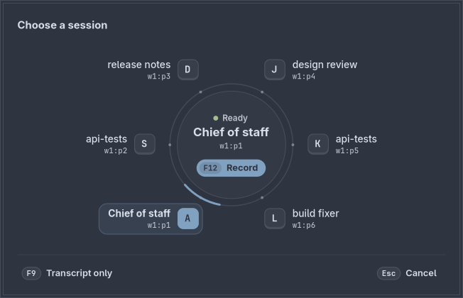 | 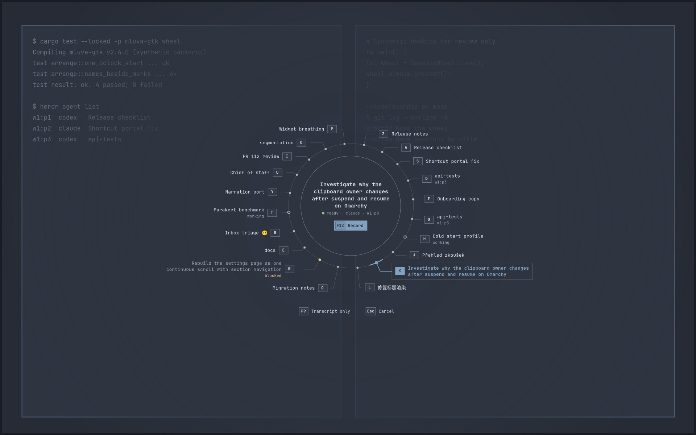 |

| One session | Six, with duplicates and a working session | 30 sessions: 26 together, remembered one on page 2 |
| --- | --- | --- |
| 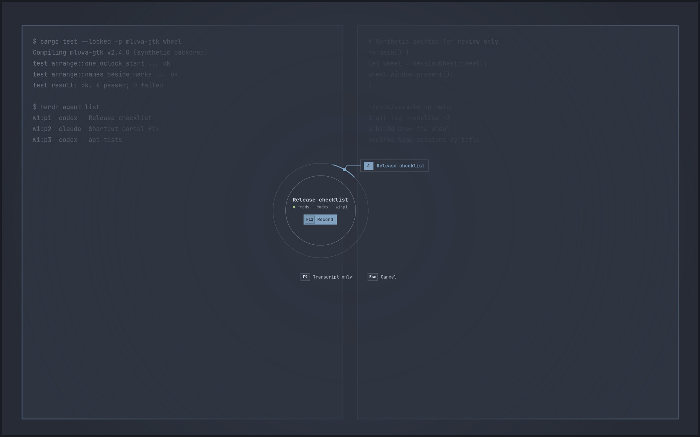 | 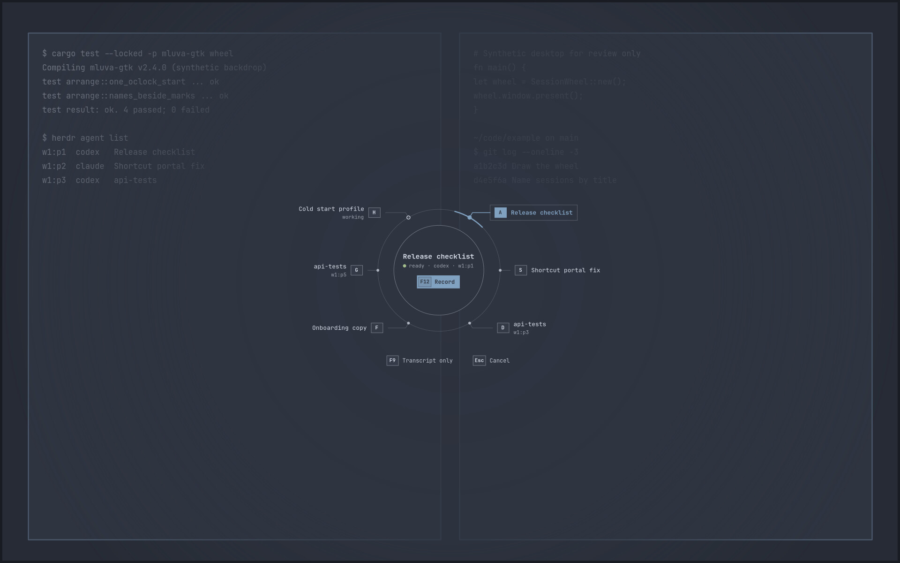 | 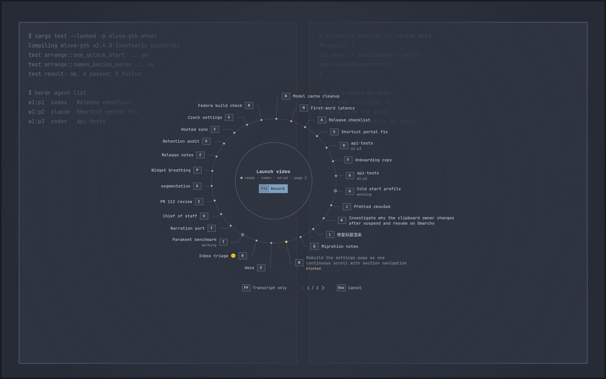 |

| Remembered session missing (selected, unavailable) | Default light palette |
| --- | --- |
| 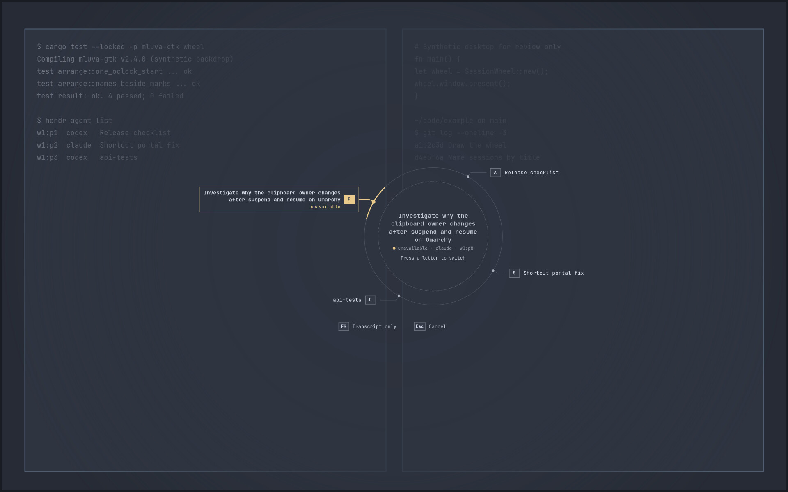 | 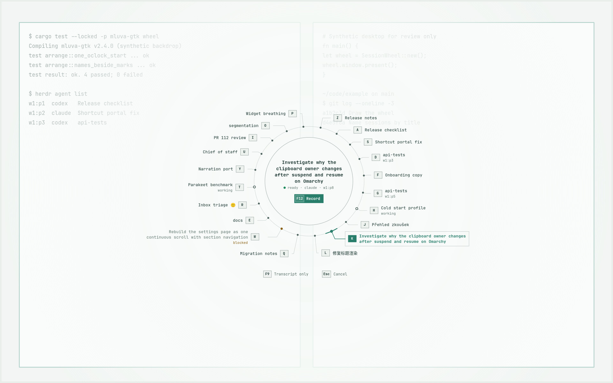 |

The window fallback on X11, at actual size:

| Twenty sessions (1083×581) | Untitled sessions fall back to Herdr name or pane | Keyboard focus on a choice / on Cancel |
| --- | --- | --- |
| 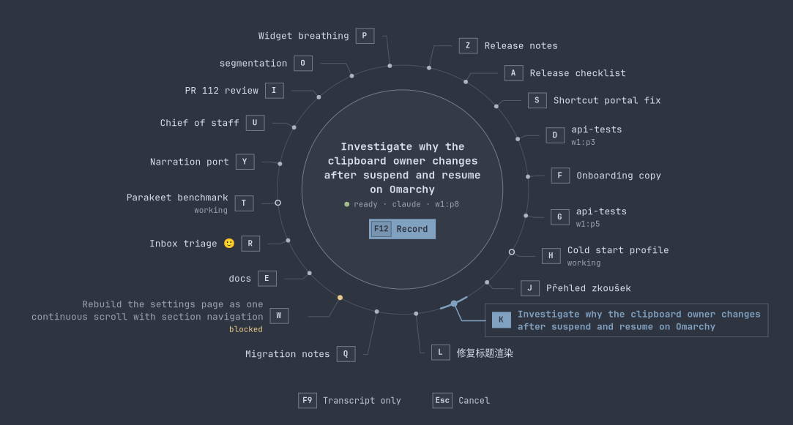 | 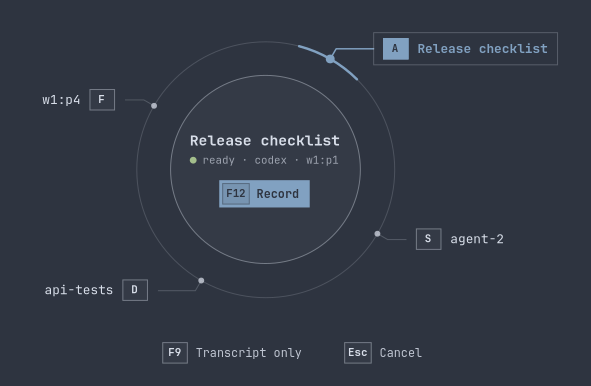 | 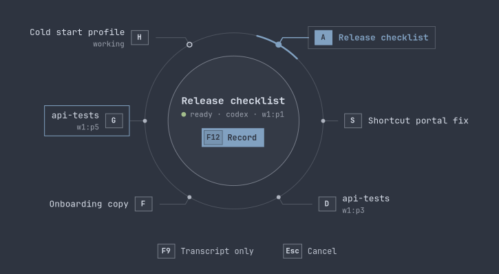  |

| One | Three | Six | Missing selected | 26 of 30 | Light | Dark, blocked selected |
| --- | --- | --- | --- | --- | --- | --- |
| 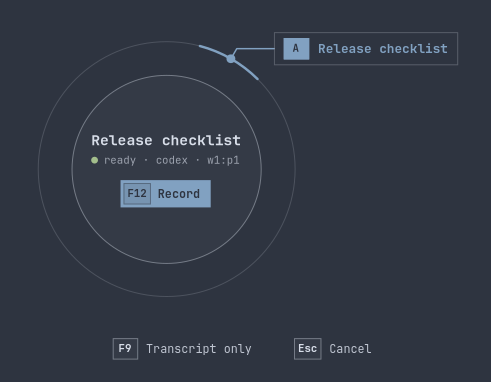 | 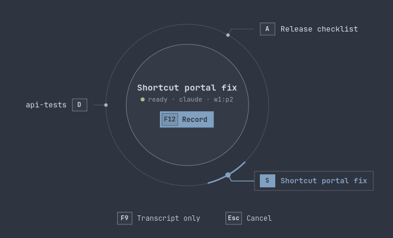 |  | 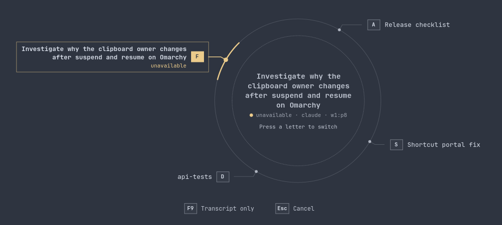 | 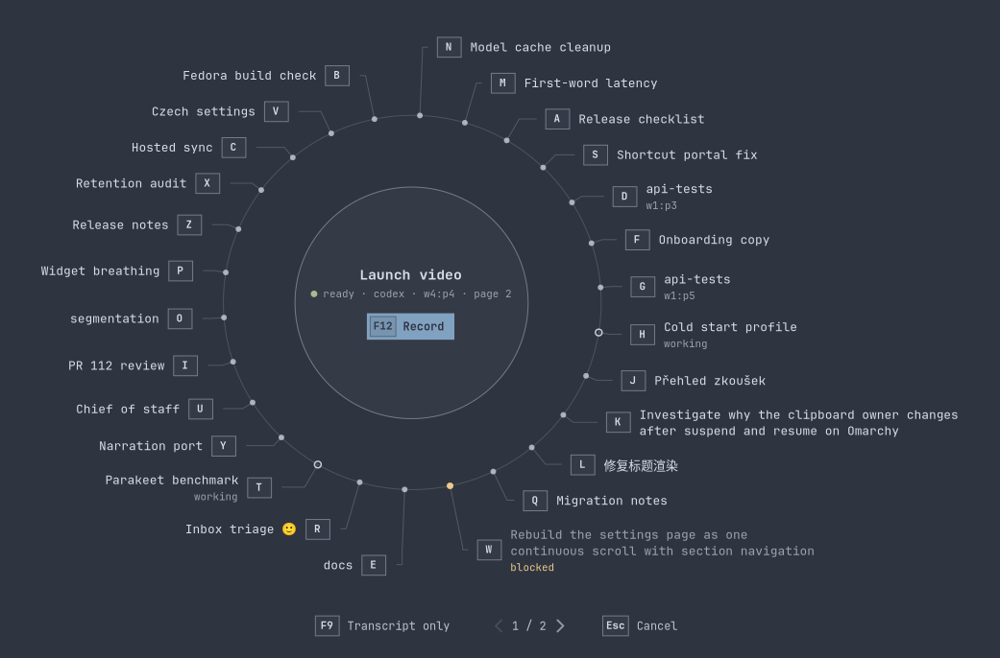 | 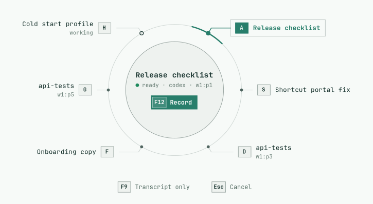 | 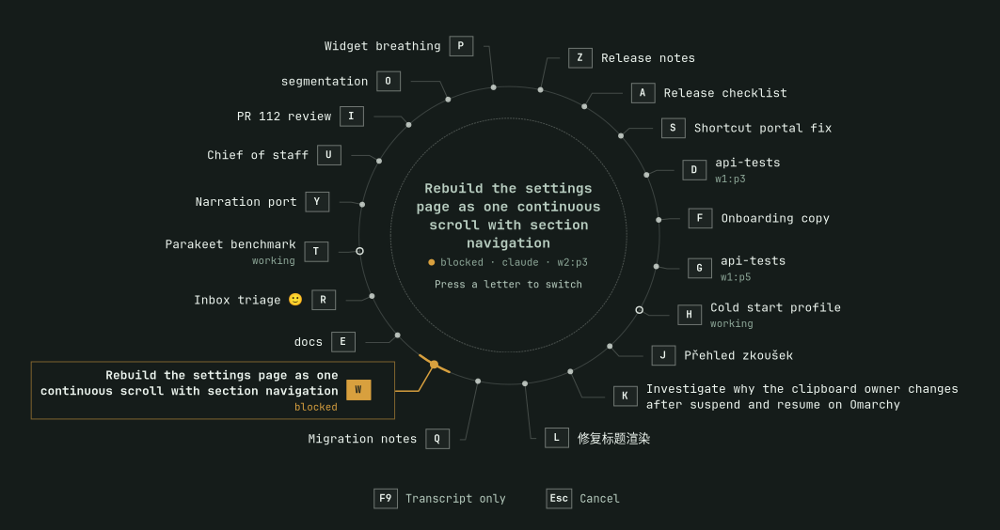 |

## Evidence

| Boundary | Evidence |
| --- | --- |
| Native gate | `make linux-test` equivalent: 170 passed, zero failed, 68 gated or ignored. Both strict Clippy configurations, formatting and generated-feature consistency passed. Geometry unit tests cover: the one o'clock start and clockwise angles; names on their own mark's side; no overlap with each other, the ring or the hub; clockwise order per side; outward leaders. On the laptop screen, for 1–26 sessions with one-line and mixed two-line names, they also check that leaders never reverse vertical direction, stay 2 px clear of the ring after leaving their mark and end level, with jogs of at most 14 px, inside a wheel that fits. |
| Name provenance | Provider tests use a Herdr peer and a Codex index fixture. They cover Claude titles, renamed Codex threads (latest wins), long and Unicode titles, the "Claude Code" product title, an unnamed Codex thread whose terminal title is only the project, and the fallback to Herdr name and pane. An index larger than 4 MiB is read from its newest whole lines. |
| Real application | `bash linux/tests/run_application_smoke.sh agent-voice` passed: 12 captures, 10 recognitions, four guarded submissions. Private X11 keys exercise selection, Escape, second F12, F9, paging at 30 sessions, server reorder and target disappearance. The app names a Claude session by its title while keeping Herdr's name for routing, and the wheel fits the private screen from zero to 20 sessions. No GTK critical warnings were logged; the four known narrow-editor allocation warnings remain. |
| Shortcut portal | `make linux-shortcut-test` passed. |
| End to end | `bash linux/tests/run_agent_end_to_end.sh /absolute/herdr` passed with production Mluva, private portal activation, synthetic PCM, an actual guarded Herdr server, actual Codex with loopback inference and actual Claude Code. First activation only displays the wheel; the next press starts capture, release keeps recording, and exactly one message receives an accepted receipt. Mluva's `herdr list` reported no title for the fresh Claude session (terminal title "Claude Code") or the unnamed Codex thread (terminal title "project"), so both fell back to their Herdr names. This run used the window path. |
| Live overlay (Hyprland 0.56.2) | With the developer's consent, a synthetic-session example opened the production wheel on the live desktop for a few seconds. `hyprctl layers` listed namespace `mluva-session-wheel` on the overlay layer of the focused monitor at its full 2560×1440 size. The developer confirmed it stayed for the whole run and looked right. A first attempt showed the window had kept its natural size; making the overlay resizable fixed that. `hyprctl layers` stopped listing the surface about 2–3 s into each run although it stayed visible; this remains unexplained. No screenshot of the desktop was taken, and the app's global F12 path was not exercised live. |
| Live metadata (read only) | One `agent.guarded_list` read against the developer's running Herdr: all six live Codex and Claude Code sessions resolved to the title held in their agent's own store. That is the Codex `thread_name` for the session ID, or Claude Code's effective `customTitle`/`aiTitle`; none showed a dispatch name. No names are recorded here. |
| Visual states | The `session_wheel_gallery` example renders the production wheel in 16 synthetic states per palette, at a chosen screen size, as a window or with `overlay` styling at screen size. The states are: one, three, six, 20 and 30 sessions; long, duplicate, Czech, CJK and emoji names; blocked, missing and untitled sessions; no selection; empty; hover; keyboard focus on the centre, a choice and Cancel; and the arc in motion. |
| Visual review | An independent finish review judged the window design against Daniel's rejection of the previous wheel and his 21 October clarifications. Those clarifications are: keep the circle, full names first, one o'clock and clockwise, room to grow for 20 sessions, and short semantic titles shown faithfully. Over three verdict passes it found these failures, all fixed: names in the wrong column for their mark from about 14 sessions up; sloped, then doubled-back leaders; selected-name contrast; a status line above the chosen name; a split "Claude Code"; and a double window frame. It ended with **ship** on those fixes. Screen-filling type scaling and a PRODUCT.md were declined. Daniel then asked for transparency and no box; the overlay replaced the window on Omarchy and he approved its look. The finish review did not re-score the overlay. |

Render the gallery inside the private desktop at the screen being judged:

```sh
cargo build --locked -p mluva-gtk --example session_wheel_gallery
OFFSCREEN_SCREEN_SPEC=1920x1200x24 bwrap --die-with-parent --bind / / --dev /dev --tmpfs /run/dbus -- \
  bash dev/run-isolated-browser.sh "$PWD/tmp/wheel-gallery" -- \
  "$CARGO_TARGET_DIR/debug/examples/session_wheel_gallery" nord "$PWD/tmp/wheel-gallery/png" overlay
```

The [machine-readable result](results.json) contains only synthetic acceptance data; session names, panes and sockets are fixtures. Apart from the live overlay row, the checks ran in a disposable X11 desktop with private HOME/XDG, D-Bus, accessibility, clipboard, audio fixtures and loopback providers. They do not establish physical F12/F9 input, a real microphone or provider, or the full live Wayland journey.
