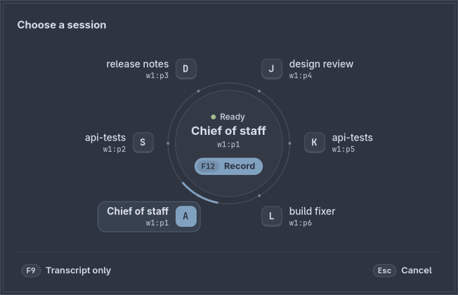
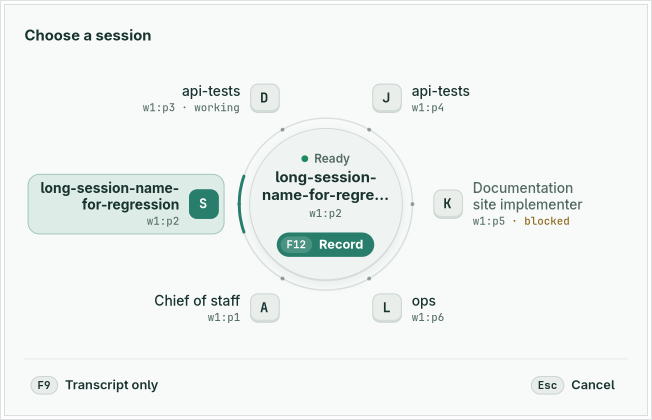
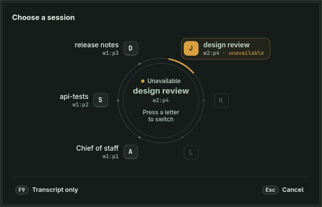
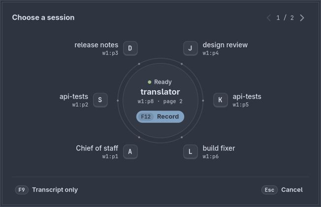

# Session wheel acceptance

The configured agent shortcut opens a session wheel before capture. With F12 configured, the first press selects only, the second starts capture for the remembered guarded recipient, and a later press stops it through the existing cancellation and delivery flow. The product default remains F8.

## Layout

The six home-row keys form an arch around one action. A S D rise up the left side and J K L descend the right, clockwise in Herdr pane order. Each key sits on a ring around the centre; the session name grows outward from it, with the exact pane ID beneath in monospace. The centre names the remembered session, its pane ID and status, and holds the record key. A short accent arc on the centre's track points at the selected key and swings the shortest way to a new choice in 220 ms. Unused letters show as dashed keys, so each key keeps its position whatever the session count.

Blocked or missing sessions stay selected and marked in warning colour; the centre withdraws Record instead of choosing a neighbour. Working sessions keep Record and show a hollow status ring. With more than six sessions, a pager appears at the top right and the centre notes when the remembered session is on another page. Names break only at spaces or hyphens; a name longer than two lines ends with an ellipsis, and the full name stays in the tooltip and accessible label. The window is fixed (652×420 in the captures); its colours come from the active Omarchy theme or Mluva's default light and dark palettes; names use the platform interface face and keys and pane IDs use JetBrains Mono.

| Nord theme, six sessions | Default light, long and duplicate names, working and blocked |
| --- | --- |
|  |  |

| Default dark, remembered session missing | Nord, remembered session on page 2 |
| --- | --- |
|  |  |

## Evidence

| Boundary | Evidence |
| --- | --- |
| Native gate | `make linux-test linux-shortcut-test`: 165 passed, zero failed, 68 gated/ignored; both strict Clippy configurations, formatting, generated-feature consistency and the private global-shortcut portal check passed. |
| Real application | `bash linux/tests/run_application_smoke.sh agent-voice`: 12 captures, 10 recognitions, four guarded submissions. Private X11 keys exercise selection, Escape, second F12, F9, paging, server reorder and target disappearance. The wheel keeps one size at minimum, narrow and wide parent windows and for zero through six choices. |
| Alternate transcript | F12 → F9 retains editable text in Mluva, preserves raw recognition and autosaves edits, without automatic clipboard, paste or agent submission. This destination remains provisional; the no-direct-agent-send behavior is confirmed. |
| End to end | `bash linux/tests/run_agent_end_to_end.sh /absolute/herdr`: production Mluva, private portal activation, synthetic PCM, actual Herdr and actual Codex with loopback Responses inference. First activation opens only; held-key repeat cannot begin capture; the next press starts, release keeps recording and exactly one synthetic message receives an accepted receipt. It was repeated after the redesign and passed. |
| Visual states | The `session_wheel_gallery` example renders the production wheel in 16 synthetic states per palette (default light, default dark and an Omarchy Nord palette): one to nine sessions, paging, long and duplicate names, working, blocked and missing targets, no selection, empty, pointer hover, keyboard focus and the selection arc in motion. |
| Visual review | An independent finish review judged the whole redesign against the request and the rejected version, returned seven material fixes. Its verdict pass scored all six design fixes resolved; the seventh asked for a separate design-tool product record, which was intentionally not added because [the product contract](../../product-contract.md) remains the product authority. Contrast computed from the palette tokens is at least 4.64:1 for every text pair checked; the reviewer's pixel measurement of the warning note on a selected unavailable session in the light palette was also 4.64:1. |

Render the gallery inside the private desktop:

```sh
cargo build --locked -p mluva-gtk --example session_wheel_gallery
bwrap --die-with-parent --bind / / --dev /dev --tmpfs /run/dbus -- \
  bash dev/run-isolated-browser.sh "$PWD/tmp/wheel-gallery" -- \
  "$CARGO_TARGET_DIR/debug/examples/session_wheel_gallery" nord "$PWD/tmp/wheel-gallery/png"
```

The [machine-readable result](results.json) contains only synthetic acceptance data. Session names, panes and sockets are fixtures. The checks ran in a disposable X11 desktop with private HOME/XDG, D-Bus, accessibility, clipboard, audio fixtures and loopback providers. They do not establish physical F12/F9, real microphone/provider or live Wayland behavior, and the captures do not show the live compositor's window frame. Normal opted-in account sharing remains governed by the existing capture policy. Later narrow-editor states emit the same four GTK allocation warnings as before the redesign; the suite and wheel assertions pass, and the warnings remain in the retained log.
