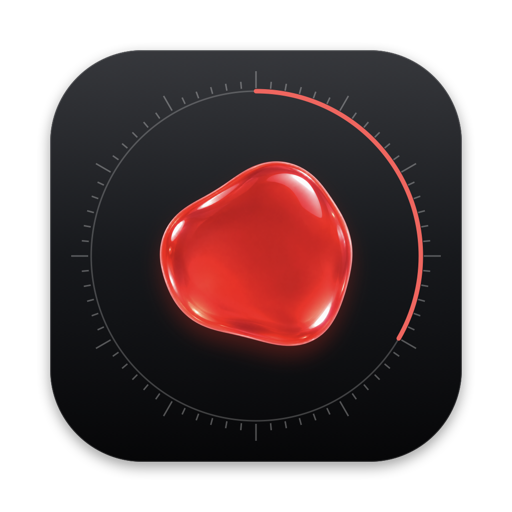

# macOS app verification

Captured on 26 October 2026 on a Mac mini (Apple silicon, macOS 26.3) from the universal release build (`macos/scripts/build-app.sh release --universal`), in the app's [evidence mode](../../../macos/README.md#evidence-mode): the real app, synthetic dictations and sessions in a temporary home, no shortcuts, microphone, provider or Herdr server. The wallpaper is the system default; no other app's windows are captured.

## Checks

| Check | Result |
| --- | --- |
| `cargo test -p mluva-ffi` | 12 bridge tests pass against real temporary stores and a synthetic Herdr server: owner-only files, settings in the Linux format, personalization and spoken commands, History edits, targets described by the shared model, recording only for a session in the latest discovery, the cancel window, send now, one delivery and its History outcome, annotation plan → render → finish → bind |
| `cargo test -p mluva-providers --lib` | 62 tests pass on macOS, among them Claude Code's inbox queue, Codex's send-if-idle queue and app server against test peers, a `flock` held by this process found through the kernel, the peer process of a Unix socket, Launch Services and Claude Code's UTC `lstart` against `ps` |
| `macos/scripts/test.sh` | 15 Swift tests pass: bridge client, PCM conversion and WAV privacy, wheel letters, paging, ring spacing and the core's identity rules, keyframe rendering through the shared planner |
| Clippy | `-D warnings` for `mluva-core`, `mluva-providers` and `mluva-ffi` on macOS and on the Linux target |
| This Mac, read only | Four live Claude Code sessions found with their inboxes in `/tmp/cc-socks`; this session's own inbox answered by its own process (connected, nothing written); the Codex daemon's PID file matched its live process and `kern.bootsessionuuid`; Codex's real locks found held by that daemon in 17 ms; the ChatGPT app's bundled `codex` recognized; `claude://` handled by Claude.app |
| Universal bundle | `x86_64 arm64`, links only system libraries, ad hoc signature with hardened runtime and the microphone entitlement |
| Intel slice | The whole evidence run completed under Rosetta (`arch -x86_64`) |
| Live launch | Started outside evidence mode in a private home with its shortcuts active: stores and settings created owner-only, no errors logged, ended on request |

## Not verified here

These paths need macOS permission grants on the physical Mac or Daniel's ElevenLabs key, which an unattended run must not approve: microphone capture and Scribe recognition end to end, Accessibility paste into another app, Screen Recording frames during a real recording, and a guarded send to a patched Herdr. Delivery to a live session was not exercised either: a message queued into a real Claude Code session, sent to a real Codex thread or opened in a new Claude chat would reach another running session or raise an app on the shared Mac. Each needs a disposable session. Their logic is covered by the tests above and by the shared Linux core.

## Screens

The interface follows [macos/DESIGN.md](../../../macos/DESIGN.md): JetBrains Mono as on Linux, keys drawn as legends, hairline rules and leader lines, graphite glass for what floats, and red only for what is live, chosen or marked.

| | |
| --- | --- |
| App icon |  |
| Menu bar |   |
| Recording pill with live words |   |
| Cancel window for a queued Claude Code message, and paste |   |
| F12 session wheel with each target's delivery level (dial redesign pending) |    |
| History |   |
| Screen annotation |    |
| Settings and Welcome |    |

[Screen recording (15 s)](mluva-macos.mp4): dictation with live words, delivery, then choosing sessions on the wheel.
