# macOS app verification

Captured on 26 October 2026 on a Mac mini (Apple silicon, macOS 26.3) from the universal release build (`macos/scripts/build-app.sh release --universal`), in the app's [evidence mode](../../../macos/README.md#evidence-mode): the real app, synthetic dictations and sessions in a temporary home, no shortcuts, microphone, provider or Herdr server. The wallpaper is the system default; no other app's windows are captured.

## Checks

| Check | Result |
| --- | --- |
| `cargo test -p mluva-ffi` | 9 bridge tests pass against real temporary stores: owner-only files, settings in the Linux format, personalization and spoken commands, History edits, guarded send cancel window, draft-only refusal, annotation plan → render → finish → bind |
| `macos/scripts/test.sh` | 15 Swift tests pass: bridge client, PCM conversion and WAV privacy, wheel letters, paging and ring spacing, keyframe rendering through the shared planner |
| Clippy | `-D warnings` for `mluva-ffi` and the changed crates on macOS and on the Linux target |
| Universal bundle | `x86_64 arm64`, links only system libraries, ad hoc signature with hardened runtime and the microphone entitlement |
| Intel slice | The whole evidence run completed under Rosetta (`arch -x86_64`) |
| Live launch | Started outside evidence mode in a private home with its shortcuts active: stores and settings created owner-only, no errors logged, ended on request |

## Not verified here

These paths need macOS permission grants on the physical Mac or Daniel's ElevenLabs key, which an unattended run must not approve: microphone capture and Scribe recognition end to end, Accessibility paste into another app, Screen Recording frames during a real recording, and a guarded send to a patched Herdr. Their logic is covered by the tests above and by the shared Linux core.

## Screens

| | |
| --- | --- |
| Menu bar | 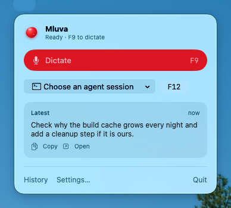 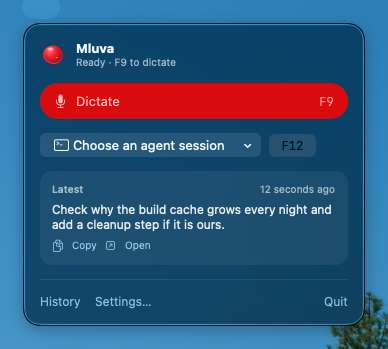 |
| Recording pill with live words |  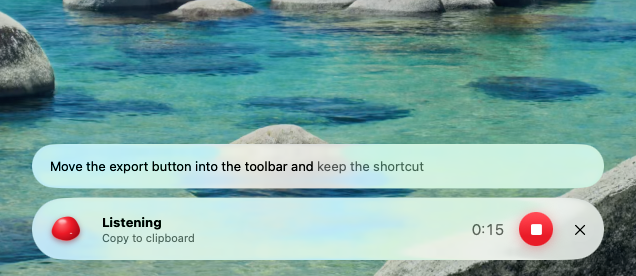 |
| Agent send countdown and paste | 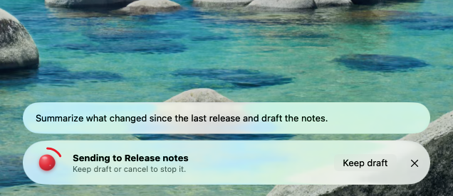 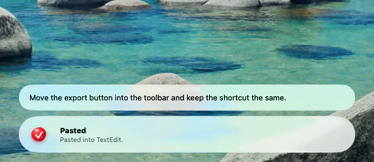 |
| F12 session wheel | 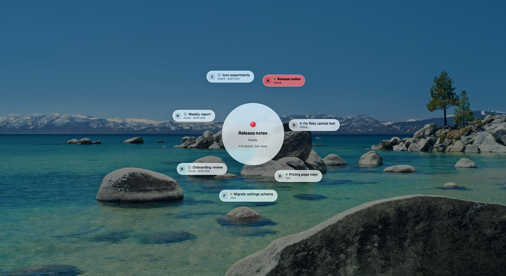 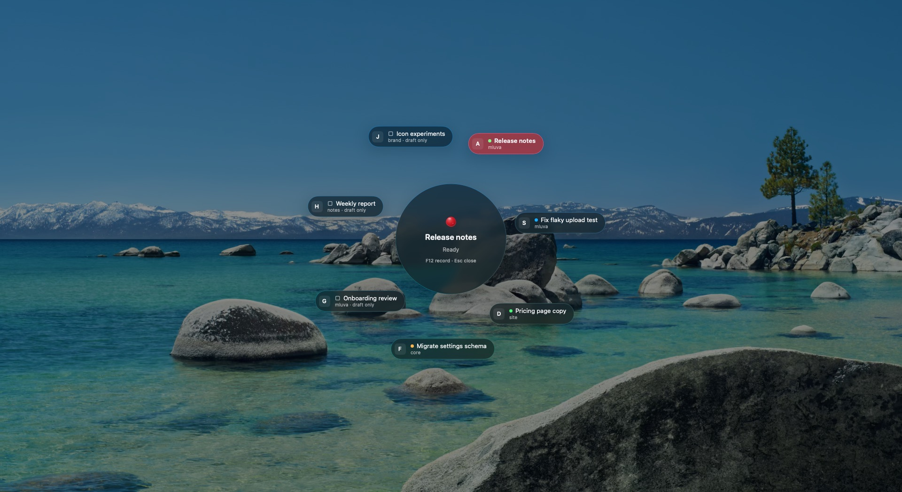 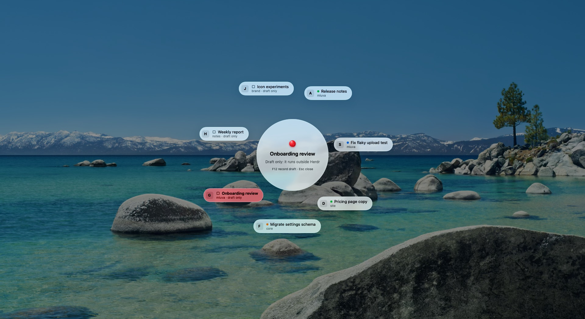 |
| History | 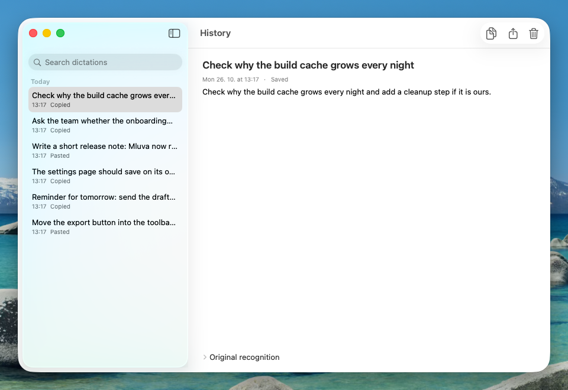 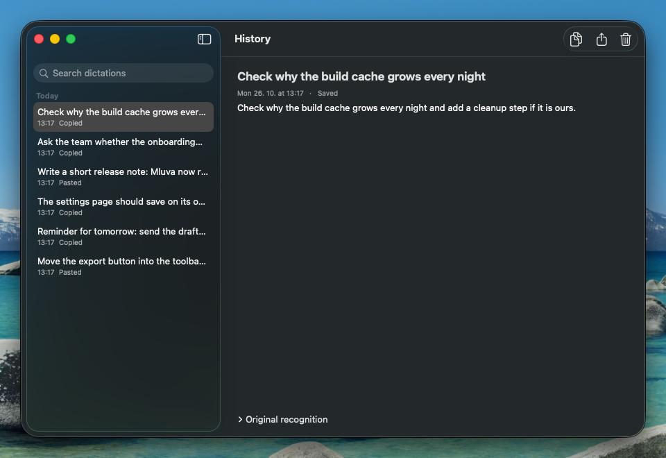 |
| Screen annotation | 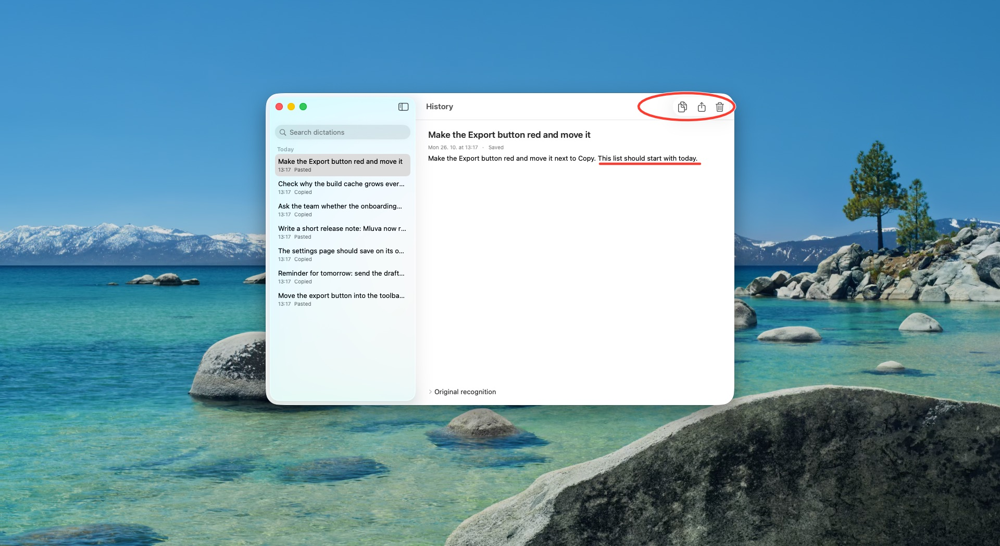 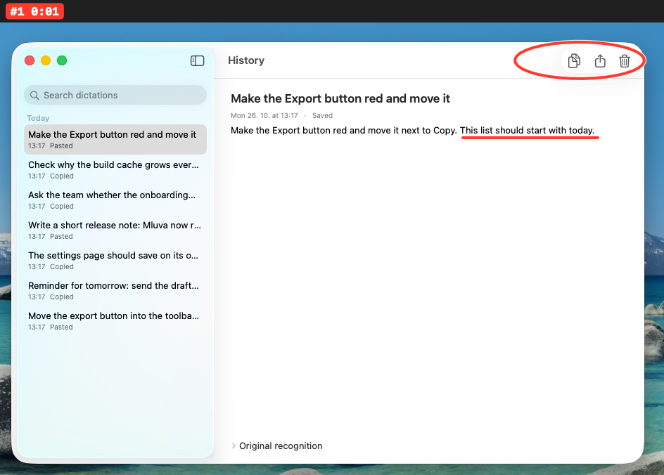 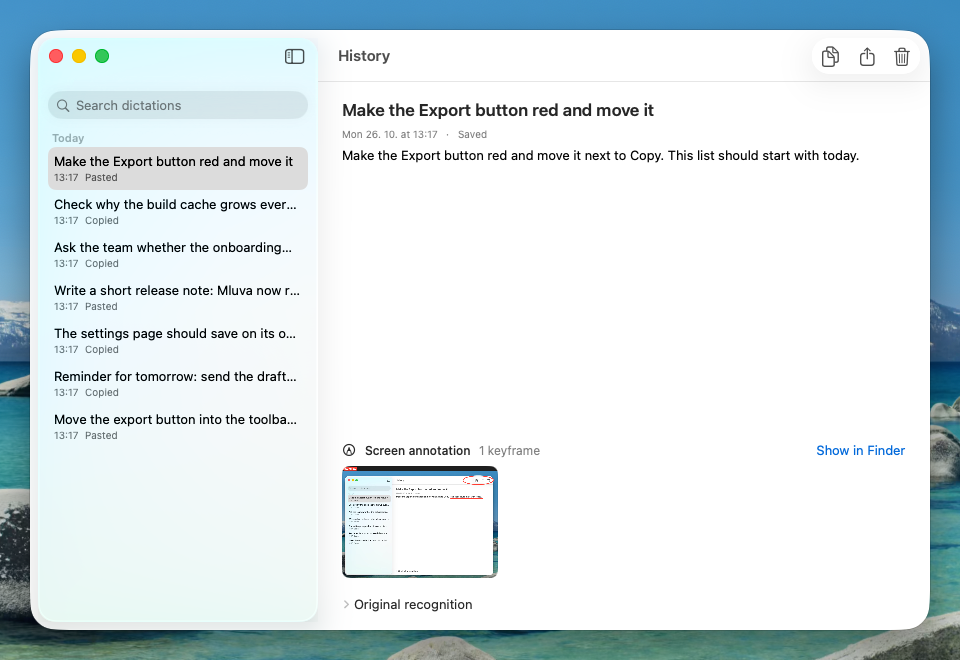 |
| Settings and Welcome | 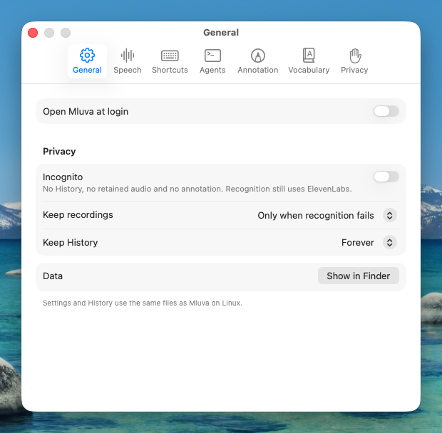 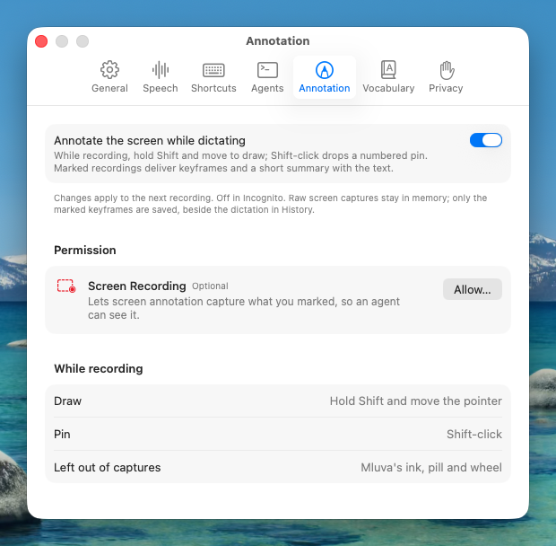 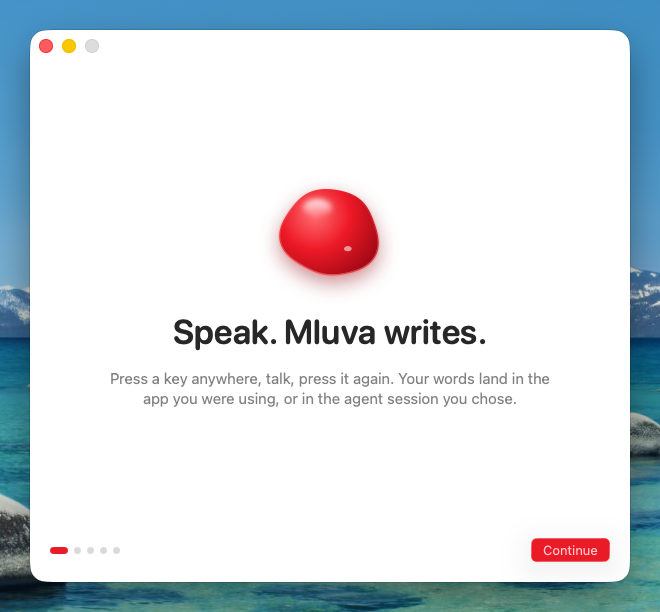 |

[Screen recording (15 s)](mluva-macos.mp4): dictation with live words, delivery, then choosing sessions on the wheel.
