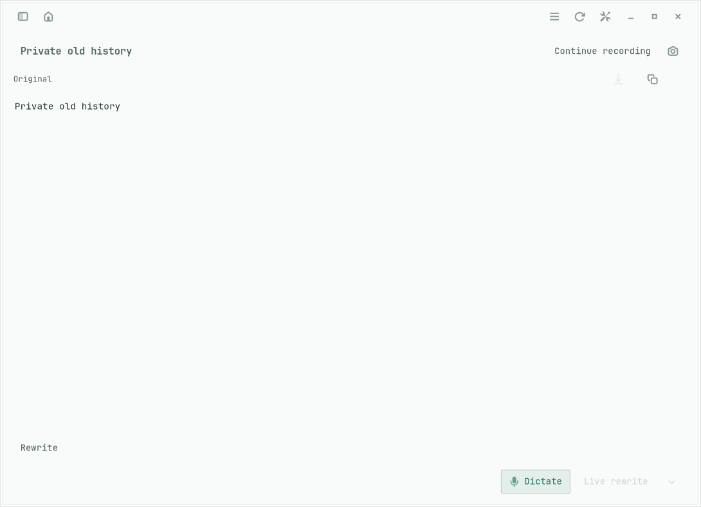
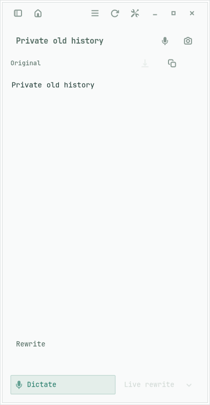
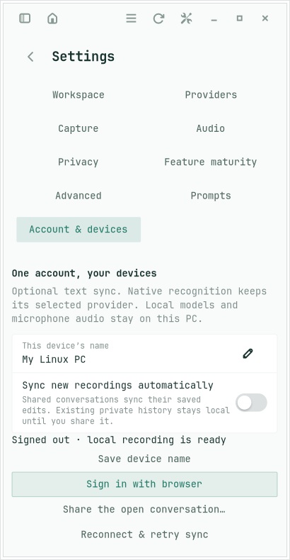

# Native account sync entry

Verified on Lenovo, 15 October 2026, from fresh `origin/main` at `5a78953d6f2211ae484ebf9d1308ddc27aa407c8`. This is the follow-up to S27-624 and PR #94: the main toolbar now exposes Account sync beside Settings. It opens Account & devices directly, focuses the sign-in control when available, and reports account status in its tooltip. Browser returns open the same panel so a successful connection or recovery message is visible. Leaving Incognito while signed out also clears the stale paused status.

The previous entry was buried in Settings, and the URI callback updated its status without navigating to it. These are the reproduced usability defects addressed here. Daniel's particular failed sign-in was not reproduced against his account; this report does not claim a new live Cognito login on his behalf.

## Checks and scope

| Check | Result |
| --- | --- |
| `make linux-test` | Passed: optimized bundle, workspace tests, both strict Clippy configurations, formatting and generated-feature consistency. |
| `make linux-account-test` | Passed: actual GTK toolbar and sign-in button, GIO default browser launch, independent loopback OAuth/PKCE peer, return after navigating away, stale return, current tooltip and Incognito recovery. Existing native/two-browser continuity, provider preservation, private history, originals/edits/rewrites, offline retry, deletion, revocation and text-only request audit still pass. |
| `make linux-application-test` | Passed: 15 workflows / 147 GTK/store states, plus the existing settings/actions suite. Historical navigation comparisons retain their original controls; the new account action and entry are checked separately. |
| `make linux-shortcut-test` | Passed: 21 portal workflows / 59 observed states. |
| ShellCheck | Passed for the required installer, Linux and dev scripts. |
| Hosted `npm run check`, `npm test`, `npm run test:browser` | Passed: 20 unit/protocol tests and 13 browser workflows. Changed native-peer fixture passes Prettier. |
| Prepared package | Installed to a disposable prefix; the actual installed binary launched from outside the checkout on a private display/bus, exported the account action, accepted the registered `mluva://account` handler and quit cleanly. |
| Local upgrade | Installed the verified bundle, restarted in the background and verified the running executable hash and exported account action. The configuration file remained byte-identical across installation. The widget status connection reconnected; both private recorder services remain active. |

The native test clicks the real sign-in control instead of creating and activating an account client directly. Its private default-browser helper captures the authorization URL; a separate Chromium process then exercises the loopback OAuth/PKCE service. Speech input and the local worker are synthetic. Display, XDG state, D-Bus, accessibility, network and devices are isolated, with native stores explicitly under the session root; no host microphone, clipboard, focus or accessibility inspection is used. Physical Wayland/browser permission handling and Daniel's own account session remain manual checks. No hosted deployment or speech activation is part of this follow-up.

## Reproduce

Use the repository-pinned Rust toolchain and prerequisites in [CONTRIBUTING.md](../../../CONTRIBUTING.md). On Lenovo, `/tmp` is tmpfs; the audio storage test deliberately expects an ordinary disk-backed temporary directory, so use the worktree's `tmp/native-test-temp` for the workspace gate.

```sh
mkdir -p tmp/native-test-temp
export TMPDIR="$PWD/tmp/native-test-temp"
export CARGO_TARGET_DIR="$PWD/tmp/native-build"
make linux-test
make linux-account-test
make linux-application-test
make linux-shortcut-test
uv run --no-project --with shellcheck-py shellcheck install.sh linux/*.sh linux/tests/*.sh dev/*.sh linux/mluva-shell
cd hosted
npm ci --ignore-scripts
npm run check
npm test
npm run test:browser
npx prettier --check tests/native-peer.mjs
```

This machine's extra GUI tools were reused from the existing verified package extraction, copied to `tmp/gui-tools`. For the application runner, add `tmp/gui-tools/bin` to `PATH`, `tmp/gui-tools/lib` to `LD_LIBRARY_PATH`, and `tmp/gui-tools/share` to `XDG_DATA_DIRS` ahead of the system defaults. These tools stay outside the host installation. The initial default-temp and missing-tool attempts failed before the corresponding checks could pass; neither required a product change.

Retained receipts: [native account](account.txt), [application](application.txt), [shortcut](shortcut.txt), [browser workflows](browser.txt), [package startup](package-startup.txt). The complete native gate log and installation backup remain in the task worktree's `tmp/`.

`npm audit` separately reports the existing high-severity `ws@8.19.0` development dependency finding; this branch does not change that dependency or its lockfile. It remains follow-up maintenance, not a passing security-audit claim.

## Visual verification

Impeccable's native refinement and audit guidance was applied to the existing GTK controls and theme. The standard Adwaita symbolic icon, accessible label, keyboard focus and tooltip preserve the existing toolbar treatment. Actual GTK captures were reviewed at requested window widths 1100, 736 and 420 pixels (the widget allocation excludes the client-side shadow). The compact editor keeps its recording controls, and Account & devices remains usable at its minimum width. All screenshot text and device names are synthetic.







## Installed artifact

The local native binary remains version 2.3.0, with this task's verified build installed at `~/.local/share/mluva/app/bin/mluva`. Its SHA-256 and the running process's executable SHA-256 both equal `7ec04562f55a57a3a121599ce08600a65e4fed0381a998b37308f2b8182aaca4`. The prior app bundle is retained under `tmp/installed-before/app`. The existing desktop entry remains the registered `mluva://` handler. No local history, models or retained audio were migrated or uploaded by this upgrade.
