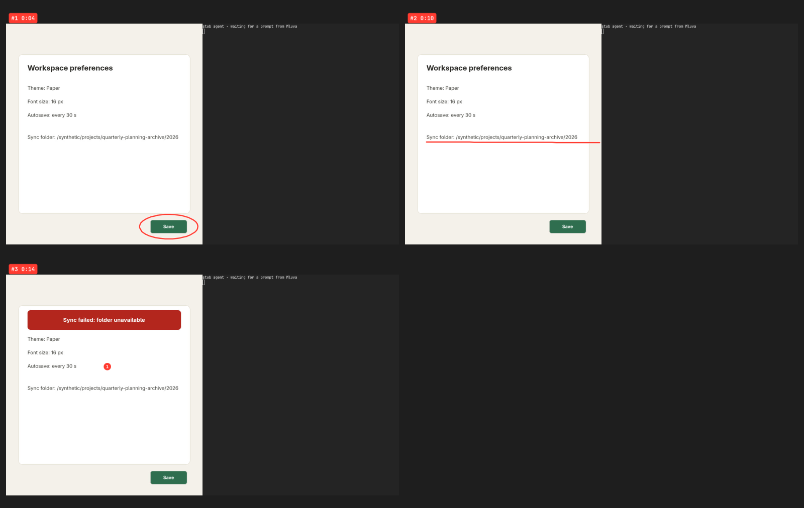

# Screen annotation verification

Screen annotation was exercised end to end with the real `mluva` executable in two places: an isolated headless Wayland compositor, and real Hyprland 0.56.2 in a QEMU/KVM virtual machine. Unit tests cover the Hyprland-specific parts. The virtual machine replaced the manual check on Hyprland. It found three defects, all fixed here.

## Offscreen end-to-end run

The [driver](offscreen/run.sh) runs a headless sway 1.12 with wlroots 0.20 that offers wlr-layer-shell, a virtual pointer and screencopy. It starts the compositor on a private `XDG_RUNTIME_DIR`, private session bus and private home, with no seat, input device, host display or host bus. In it, the production executable records to a Herdr agent, draws through its own layer-shell overlay, and delivers through the guarded Herdr send. Every substituted boundary is synthetic:

| Boundary | Substitute |
| --- | --- |
| Microphone | `pw-record` replaced by the repository's audio fixture, emitting quiet PCM at real-time pace |
| Speech provider | A [loopback compatible peer](offscreen/speech_peer.py) returning a scripted narration: the sentence for each 3 s preview chunk, all of it for the final upload |
| Screen | A [synthetic settings page](offscreen/synthetic_settings.py) with a misplaced Save button, an overflowing label and a scripted error banner |
| Shift and Shift-click | Mluva's `annotation-ink-down`, `annotation-ink-up` and `annotation-pin` application actions over the private bus; strokes from a `zwlr_virtual_pointer_v1` client |
| Agent | The repository's Herdr protocol fixture peer, with a [stub agent](offscreen/stub_agent.py) in a `foot` terminal printing each guarded prompt verbatim |

Run it from the repository root once a layer-shell harness and the debug binaries exist: `bash docs/verification/screen-annotations/offscreen/run.sh /path/to/layer-shell-harness.sh tmp/<new-run>`. The harness used here ran the system's sway 1.12 and wlroots 0.20.2 Arch packages; `MLUVA_BINARIES` selects prebuilt binaries and `VPTR` the virtual-pointer client.

### Result

The [evidence](evidence/) comes from one run on 23 October 2026 with debug binaries built from `1002c33`, which shortens the bundle paths on top of `main` after #115 ([hashes](evidence/binaries.sha256)). The timeline is in [driver.log](evidence/driver.log); times below are on the recording's sample clock.

| Check | Observed |
| --- | --- |
| Drawing reaches the overlay | Live ink over the synthetic page while Shift was held ([screenshot](evidence/02-drawing-circle.png)); ordinary windows kept their input |
| Clean frames | Each keyframe was grabbed before its ink showed; the ink in the frames is composited from vectors. Only two raw frames were kept: the underline reused the circle's unchanged screen, keeping its own time, and the pin's frame shows the banner |
| No frames before drawing | Nothing was grabbed before the first ink on this desktop, which binds no Shift; sampling started with it |
| Keyframes | 3 for 3 separate gestures: circle at 0:04, underline at 0:10, pin at 0:14. The banner change and the spoken "Now" were not separate keyframes because the pin's frame already shows that screen |
| Crops | Whole screen, because this compositor reports no window geometry; no text is cut. Whole-window crops on Hyprland are covered by unit tests on synthetic geometry |
| Clause matching | Each keyframe carries the words heard while it was on screen, on the preview-growth fallback ([summary](evidence/bundle/summary.md)). At 3 s preview chunks, the start of the banner sentence spills into the underline's line |
| Delivery | One guarded `agent.prompt_guarded` after the two-second window, its text exactly the transcript, a blank line and `summary.md` without its final newline ([prompt](evidence/delivered-prompt.txt), [terminal](evidence/04-agent-received.png)) |
| Paths | The bundle is `annotations/51e4ca24/` with `01.png` to `03.png` and `sheet.png` directly inside. Under this run's synthetic home a keyframe path is 73 characters and the contact sheet's 76, against 114 and 112 for the earlier `<uuid>/frames/frame-NN.png` layout ([summary](evidence/bundle/summary.md)) |
| History | Raw and working text are the transcript only; the bundle belongs to that conversation with 3 keyframes ([history](evidence/history.json)) |
| Privacy | Bundle directory `0700`, files `0600` ([modes](evidence/bundle-modes.txt)); no raw-frame directory left after Quit ([count](evidence/leftover-frame-directories.txt)) |
| Speech | Six 3 s preview chunks and one 18.0 s final upload to the loopback peer ([requests](evidence/speech-requests.jsonl)) |

## Real Hyprland in a virtual machine

The [harness](hyprland-vm/README.md) runs Arch Linux in QEMU/KVM, headless, on a virgl GPU, with the workstation's versions: Hyprland 0.56.2 (commit `efb5099`), xdg-desktop-portal-hyprland 1.4.1, xdg-desktop-portal 1.22.1 and GTK 4.22.4.

- **Input.** QMP drives the guest's USB keyboard and tablet, which libinput sees as physical devices.
- **Observation.** Everything is read inside the guest: `hyprctl`, `grim`, and a probe text app that logs the keys, clicks, text and selection it receives.
- **Mluva.** Mluva uses the managed Lua shortcut bridge, as on the workstation. Speech comes from the loopback peer, and the agent is the Herdr fixture peer with a stub agent in `foot`.
- **Build.** Debug binaries from `189f948`, the head of the fixes ([hashes](hyprland-vm/evidence/binaries.sha256)), run on 23 October 2026. These bundles predate the short paths and show the earlier `<uuid>/frames/frame-NN.png` layout. The path change touches no platform code, so it was verified offscreen only.

| Check | Result |
| --- | --- |
| Bindings appear | **Pass.** During an F9 recording, `hyprctl -j binds` lists `Mluva annotation: annotate-ink` (`Shift_L`, modmask 0, `non_consuming`) and `annotate-pin` (`mouse:272`, modmask 1 = Shift). `hyprctl` does not report `ignore_mods` or `transparent`; the press and release below show both work. [Bindings](hyprland-vm/evidence/f9/02-bindings-recording.json) |
| Shift still types capitals | **Pass.** ` Hello World` was typed on the USB keyboard. The probe received `H` and `W` with Shift, its text reads ` Hello World`, and 0 ink pixels appeared. [Keys](hyprland-vm/evidence/f9/capitals-keys.jsonl), [text](hyprland-vm/evidence/f9/capitals-state.json) |
| Drawing works | **Pass.** Shift plus tablet motion draws over a floating window ([screenshot](hyprland-vm/evidence/f9/03-drawing-circle.png)). On the probe's clock, ink stays solid until 697 ms after Shift release, fades from 727 ms and is gone by 1,244 ms; the design is 0.7 s plus 0.6 s ([frames](hyprland-vm/evidence/lifecycle/13-fade.jsonl)). An ordinary click with Shift up reached the probe ([click](hyprland-vm/evidence/f9/ordinary-click.jsonl)). |
| Pins work | **Pass.** A Shift-click without movement on the word "kappa": the probe received only Shift's press and release, no click ([events](hyprland-vm/evidence/f9/pin-probe-events.jsonl)). Its selection stayed `{"selected": false, "cursor": 79}` ([before](hyprland-vm/evidence/f9/pin-before-state.json), [after](hyprland-vm/evidence/f9/pin-after-state.json)), and the primary selection stayed empty. [Screenshot](hyprland-vm/evidence/f9/04-pin-on-text.png) |
| Stop delivers | **Pass.** F9 Stop inserted through AT-SPI, at the caret captured at Start: exactly the transcript, a blank line and `summary.md` without its final newline ([text](hyprland-vm/evidence/f9/delivered-text-field.txt), [screenshot](hyprland-vm/evidence/f9/05-delivered-text-field.png)). F8 to the selected agent sent one guarded prompt with the same text, which the stub agent printed ([prompt](hyprland-vm/evidence/agent/delivered-prompt.txt), [terminal](hyprland-vm/evidence/agent/07-agent-received.png)). |
| Frames are right | **Pass.** Keyframes crop to whole windows from the guest's `j/clients` geometry, with a 16 px margin: the floating settings page (`700,150 700×760` → `684,134–1416,926`), the probe, and the stub agent's terminal (`966,10 944×1060` → `942,0–1920,1080`). Ink and `#N M:SS` badges are composited ([contact sheet](hyprland-vm/evidence/f9/bundle/contact-sheet.png), [agent's](hyprland-vm/evidence/agent/bundle/contact-sheet.png)). |
| Bindings removed | **Pass.** Both annotation bindings are gone after Stop and after Ctrl+Alt+Escape. After SIGKILL of Mluva, its watchdog removed them within 3 s. When Mluva and the watchdog were killed together, the next start removed them, along with the leftover raw-frame directory ([lifecycle](hyprland-vm/evidence/lifecycle/)). |
| Missing portal | **Pass.** With `MLUVA_DISABLE_GLOBAL_SHORTCUT=1`, a recording started through `global-record` shows "Screen annotation needs Mluva's desktop shortcuts to be approved, so Shift is not bound. Recording continues without it." ([screenshot](hyprland-vm/evidence/lifecycle/11-portal-off-status.png)). No annotation binding is added, and Shift-click selects text in the probe (`ppa lambda mu`, also in the primary selection). |
| Absorbed first click | **Measured.** 5 of 5 clicks without movement right after Shift release never reached the probe's button; 5 of 5 after a 2 px move did ([counts](hyprland-vm/evidence/lifecycle/12-absorbed-clicks.txt)). |
| Two outputs, fractional scale | **Pass.** Virtual-1 is at scale 1, and Virtual-2 (1920×1080) at scale 1.5 to its right. Live ink follows the tablet on Virtual-2 ([screenshot](hyprland-vm/evidence/two/14-two-outputs-drawing.png)). A circle and a pin there crop to the notes window in Virtual-2's logical coordinates (`10,366 624×344` → `0,350–650,720`), rendered at 1.5×. The underline on Virtual-1 crops to the probe ([contact sheet](hyprland-vm/evidence/two/bundle/contact-sheet.png)). |

### Defects found and fixed

- **A pin's keyframe could show a stale screen at 1920×1080 and above.**
  - **Seen.** An error banner (500×64) appeared and was pinned. The keyframe showed the screen from before it ([before the fix](hyprland-vm/evidence/before-fixes/stale-pin-frame-contact-sheet.png)).
  - **Cause.** The pin's clean frame was discarded as unchanged. The change score used the global mean and the fourth-most-changed of 8×6 blocks, and the banner touched only three blocks. At 1280×720 in the offscreen run it touched four, so that run could not show this.
  - **Fix.** The score also counts the share of thumbnail samples that visibly changed. Test: `a_banner_is_a_new_screen_while_a_moving_pointer_is_not`, at 1280×720, 1920×1080, and 2880×1800 at scale 1.5.
- **Ink stayed on after typing a capital or a Shift-click.**
  - **Cause.** Hyprland shadows a binding whose key is still held once another key is released, unless the binding is `transparent`. Lua bindings use the `__lua` handler, which is not exempt, so the Shift release after a capital or a pin never reached Mluva.
  - **Effect.** Mluva stayed in ink mode: plain pointer motion drew ([before the fix](hyprland-vm/evidence/before-fixes/ink-stuck-after-capital.png)), clicks went to the overlay, and the next Shift press was ignored.
  - **Fix.** The ink binding is now `transparent`. Test: `the_shift_release_survives_a_capital_or_a_shift_click`. The portal now reports both press and release for a capital and for a pin, and plain motion afterwards draws nothing.
- **A stroke begun with the Shift press lost its start.**
  - **Cause.** The overlay takes the pointer 70–85 ms after the press, and motion before then reaches the window underneath.
  - **Fix.** Mluva now reads the pointer when the portal reports the press, as pins do, and leads the press's first stroke with that point, in the bundle and in the live ink. Test: `the_pointer_at_the_shift_press_leads_the_first_stroke`.
  - **Remaining gap.** See the first open item.

### Open items

- **Delay at the Shift press.**
  - The portal reports the press 0.5–0.7 ms after the kernel does. Mluva reads the pointer 5–45 ms later, and the overlay takes over after about 75 ms.
  - The delay is the same in release and debug builds and with the GL or Cairo renderer, so it is Mluva's main loop. The [measurements](hyprland-vm/evidence/measurements.md) give the figures.
  - A stroke begun in the same instant as Shift therefore starts about 50 ms of motion late. One begun after a 50 ms pause loses nothing.
- **Insertion fallback after a click in the target.**
  - Automatic insertion into the probe sometimes fell back to the clipboard, with "The captured text target could not be restored, so no paste was attempted": in 3 of 5 annotated recordings in which a button in the target window was clicked, against 0 of 4 with annotation off.
  - It inserted every time on 21 October and in the final runs ([comparison](hyprland-vm/evidence/insertion/15-insertion-after-button.txt)). The clipboard always held the full text. The cause is not known.
- **Absorbed first click.** Unchanged, as decided; measured above.

## Unit and integration tests

| Area | Tests |
| --- | --- |
| Marks | Circles, underlines, arrows and taps; quick strokes grouped, pins and other screens kept apart (`rust/mluva-annotate/src/sketch.rs`) |
| Keyframes | Every mark kept, distinct moments only, a banner inside three blocks is a new screen at 1920×1080 and 2880×1800 while a moving pointer is not, twelve at most with sixteen marks, separate gestures keep their own keyframe and words, Czech and English cues (`keyframes.rs`) |
| Timing | Provider words preferred, preview growth interpolated, even spread as the last resort, clauses partitioned (`timing.rs`) |
| Crops | Marks crop to the whole window under them, the smaller one when a floating window overlaps a tiled one, widened to keep every mark; marks over no window keep every window they touch; other keyframes show the focused window; without geometry the whole screen (`rust/mluva-annotate/src/render.rs`) |
| Bundle | Synthetic HiDPI frames rendered, cropped and badged; keyframes and `sheet.png` directly in the bundle; owner-only files; a removed directory is never recreated (`rust/mluva-annotate/tests/bundle.rs`) |
| Storage | Short identifiers; an identifier whose directory or row exists is skipped, never reused, and creation fails after a bounded number of attempts; both identifier forms accepted and links, traversal and other names refused; stable paths while ownership moves; deletion, pruning and merge follow the conversation; Markdown export links keyframes; a bundle from an earlier release keeps its UUID layout through export, recovery and pruning; startup recovery keeps a finished bundle and removes one without a summary or with a missing frame (`rust/mluva-core/src/annotations.rs`, `rust/mluva-core/tests/annotation_store.rs`, `rust/mluva-workflows/tests/services.rs`) |
| Delivery | The summary follows final recognition in the delivered message while raw and working text stay the transcript; silence builds nothing (`rust/mluva-workflows/tests/delivery_appendix.rs`) |
| Clock | Marks use written samples, not wall time (`rust/mluva-workflows/tests/sample_clock.rs`) |
| Scribe batch | Word times kept without spacing or audio events (`rust/mluva-providers/tests/contracts.rs`) |
| Hyprland bindings | Shift and Shift-click scripts, the Shift binding transparent so a capital or pin keeps its release, conflicts with other bindings, removal after an `eval` timeout, a failed verification or an unconfirmed binding, logical output sizes, visible windows per output, class-only focus events; a Lua run proves one recording's late cleanup never removes the next one's bindings (`rust/mluva-gtk/src/screen_annotation/hyprland.rs`) |
| Portal actions | Registration reported to the application, refused when the portal approves nothing; ink press and release, including a release without its press, pins on every click, nothing after shutdown (`rust/mluva-gtk/tests/global_shortcuts.rs`); bindings wait for registration (`rust/mluva-gtk/src/application/annotations.rs`) |
| Session | Drift is not ink; the pointer at the Shift press leads the press's first stroke; only ink, pins or a pin being located mark a recording; the frame bound evicts change samples first and never mark frames; stale frame directories go, links and the current one stay; frames only on memory-backed filesystems (`rust/mluva-gtk/src/screen_annotation/session.rs`) |

## Not proven

- **Daniel's hardware.** His keyboard, touchpad and mouse; his GPUs; his 2880×1800 panel and monitors. The guest renders through virgl and draws the cursor into frames. Its second output is a virtual 1920×1080 head at scale 1.5.
- **Omarchy.** The bar, its screencast indicator during frame grabs, and the rest of Daniel's Hyprland configuration. The guest ran a minimal configuration with his `follow_mouse` and keyboard layouts.
- **Release-build behaviour.** The evidence used debug binaries; a release build measured only the Shift-press delay.
- **Live speech providers and the live Herdr.** Scribe realtime and local models were not used, and clause matching ran on the preview-growth fallback.
- **Physical input timing.** QMP events reach the guest through emulated USB devices that the guest polls.
