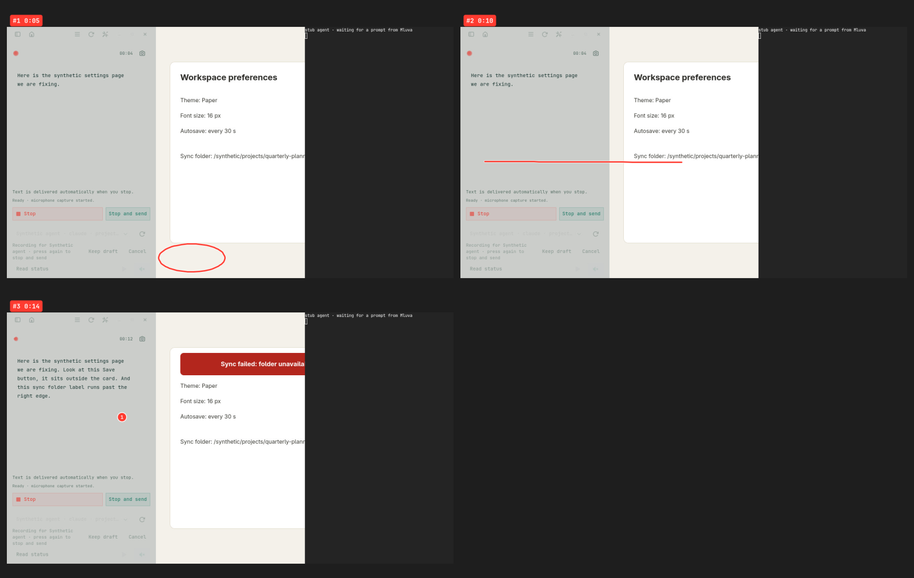

# Screen annotation verification

Screen annotation was exercised end to end with the real `mluva` executable in an isolated headless Wayland compositor, and its Hyprland-specific parts with unit tests. A short manual check on a real Hyprland session remains open.

## Offscreen end-to-end run

The [driver](offscreen/run.sh) runs a headless sway 1.12 with wlroots 0.20 that offers wlr-layer-shell, a virtual pointer and screencopy. It starts the compositor on a private `XDG_RUNTIME_DIR`, private session bus and private home, with no seat, input device, host display or host bus. In it, the production executable records to a Herdr agent, draws through its own layer-shell overlay, and delivers through the guarded Herdr send. Every substituted boundary is synthetic:

| Boundary | Substitute |
| --- | --- |
| Microphone | `pw-record` replaced by the repository's audio fixture, emitting quiet PCM at real-time pace |
| Speech provider | A [loopback compatible peer](offscreen/speech_peer.py) returning a scripted narration: the sentence for each 3 s preview chunk, all of it for the final upload |
| Screen | A [synthetic settings page](offscreen/synthetic_settings.py) with a misplaced Save button, an overflowing label and a scripted error banner |
| Shift and Shift-click | Mluva's `annotation-ink-down`, `annotation-ink-up` and `annotation-pin` application actions over the private bus; strokes from a `zwlr_virtual_pointer_v1` client |
| Agent | The repository's Herdr protocol fixture peer, with a [stub agent](offscreen/stub_agent.py) in a `foot` terminal printing each guarded prompt verbatim |

Run it from the repository root once a layer-shell harness and the debug binaries exist: `bash docs/verification/screen-annotations/offscreen/run.sh /path/to/layer-shell-harness.sh tmp/<new-run>`. The harness used here ran the system's sway 1.12 and wlroots 0.20.2 Arch packages; `MLUVA_BINARIES` selects prebuilt binaries and `VPTR` the virtual-pointer client.

### Result

The [evidence](evidence/) comes from one run on 21 October 2026 with debug binaries built from `b1ba83e`, the branch merged with `main` after #112 ([hashes](evidence/binaries.sha256)). The timeline is in [driver.log](evidence/driver.log); times below are on the recording's sample clock.

| Check | Observed |
| --- | --- |
| Drawing reaches the overlay | Live ink over the synthetic page while Shift was held ([screenshot](evidence/02-drawing-circle.png)); ordinary windows kept their input |
| Clean frames | Each keyframe was grabbed before its ink showed; the ink in the frames is composited from vectors. Only two raw frames were kept: the underline and the pin reused unchanged screens, keeping their own times |
| No frames before drawing | Nothing was grabbed before the first ink on this desktop, which binds no Shift; sampling started with it |
| Keyframes | 3 for 3 separate gestures: circle at 0:05, underline at 0:10, pin at 0:14. The banner change and the spoken "Now" were not separate keyframes because the pin's frame already shows that screen |
| Crops | Whole screen, because this compositor reports no window geometry; no text is cut. Whole-window crops on Hyprland are covered by unit tests on synthetic geometry |
| Clause matching | Each keyframe carries the words heard while it was on screen, on the preview-growth fallback ([summary](evidence/bundle/summary.md)). At 3 s preview chunks, the start of the banner sentence spills into the underline's line |
| Delivery | One guarded `agent.prompt_guarded` after the two-second window, its text exactly the transcript, a blank line and `summary.md` ([prompt](evidence/delivered-prompt.txt), [terminal](evidence/04-agent-received.png)) |
| History | Raw and working text are the transcript only; the bundle belongs to that conversation with 3 keyframes ([history](evidence/history.json)) |
| Privacy | Bundle directories `0700`, files `0600` ([modes](evidence/bundle-modes.txt)); no raw-frame directory left after Quit ([count](evidence/leftover-frame-directories.txt)) |
| Speech | Five 3 s preview chunks and one 17.9 s final upload to the loopback peer ([requests](evidence/speech-requests.jsonl)) |

## Unit and integration tests

| Area | Tests |
| --- | --- |
| Marks | Circles, underlines, arrows and taps; quick strokes grouped, pins and other screens kept apart (`rust/mluva-annotate/src/sketch.rs`) |
| Keyframes | Every mark kept, distinct moments only, twelve at most with sixteen marks, separate gestures keep their own keyframe and words, Czech and English cues (`keyframes.rs`) |
| Timing | Provider words preferred, preview growth interpolated, even spread as the last resort, clauses partitioned (`timing.rs`) |
| Crops | Marks crop to the whole window under them, the smaller one when a floating window overlaps a tiled one, widened to keep every mark; marks over no window keep every window they touch; other keyframes show the focused window; without geometry the whole screen (`rust/mluva-annotate/src/render.rs`) |
| Bundle | Synthetic HiDPI frames rendered, cropped and badged; owner-only files; a removed directory is never recreated (`rust/mluva-annotate/tests/bundle.rs`) |
| Storage | Stable paths while ownership moves; deletion, pruning and merge follow the conversation; Markdown export links keyframes; startup recovery keeps a finished bundle and removes one without a summary or with a missing frame (`rust/mluva-core/tests/annotation_store.rs`, `rust/mluva-workflows/tests/services.rs`) |
| Delivery | The summary follows final recognition in the delivered message while raw and working text stay the transcript; silence builds nothing (`rust/mluva-workflows/tests/delivery_appendix.rs`) |
| Clock | Marks use written samples, not wall time (`rust/mluva-workflows/tests/sample_clock.rs`) |
| Scribe batch | Word times kept without spacing or audio events (`rust/mluva-providers/tests/contracts.rs`) |
| Hyprland bindings | Shift and Shift-click scripts, conflicts with other bindings, removal after an `eval` timeout, a failed verification or an unconfirmed binding, logical output sizes, visible windows per output, class-only focus events; a Lua run proves one recording's late cleanup never removes the next one's bindings (`rust/mluva-gtk/src/screen_annotation/hyprland.rs`) |
| Portal actions | Registration reported to the application, refused when the portal approves nothing; ink press and release, including a release without its press, pins on every click, nothing after shutdown (`rust/mluva-gtk/tests/global_shortcuts.rs`); bindings wait for registration (`rust/mluva-gtk/src/application/annotations.rs`) |
| Session | Drift is not ink; only ink, pins or a pin being located mark a recording; the frame bound evicts change samples first and never mark frames; stale frame directories go, links and the current one stay; frames only on memory-backed filesystems (`rust/mluva-gtk/src/screen_annotation/session.rs`) |

## Not proven here

- **Hyprland itself.** No Hyprland ran: stock Hyprland 0.56.2 cannot start headless without a seat or KMS session, and nesting it in the available headless compositors fails. The `Shift_L` binding with `ignore_mods` and `non_consuming`, Activated and Deactivated through xdg-desktop-portal-hyprland, the consuming Shift-click pin binding, `cursorpos`, `j/clients` window geometry and whole-window crops, socket2 focus events, the startup cleanup and the removal at Stop are covered by unit tests and source reading of Hyprland 0.56.2, not by a run.
- **Physical input.** Real keyboards were not used: capitals typed while Shift is bound, Shift with other modifiers, and the first click after releasing Shift without moving.
- **Daniel's monitors.** One 1280×720 output at scale 1. Multiple monitors, fractional scaling and the panel's resolution, including frame-grab cost and Hyprland's screencast indicator, are untested.
- **Live speech providers and the live Herdr.** Scribe realtime and local models were not used; clause matching ran on the preview-growth fallback.

## Manual check on Hyprland

With Daniel's go-ahead, on his session: enable the setting, start agent dictation into a scratch session, and confirm that:

- `hyprctl -j binds` lists `Mluva annotation: annotate-ink` and `annotate-pin` while recording;
- a capital letter still types;
- holding Shift and moving draws, and releasing fades the ink;
- Shift-click without moving drops a pin without selecting text;
- the summary arrives, its frames open and crop to whole windows;
- both bindings are gone from `hyprctl -j binds` after Stop.

Also check that with the portal shortcuts not approved, recording shows the "needs Mluva's desktop shortcuts" status and Shift-click keeps working in applications.
