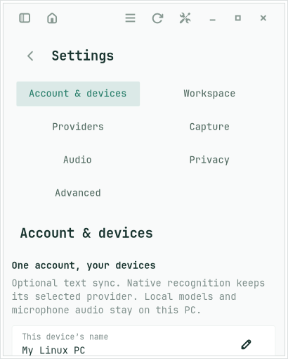
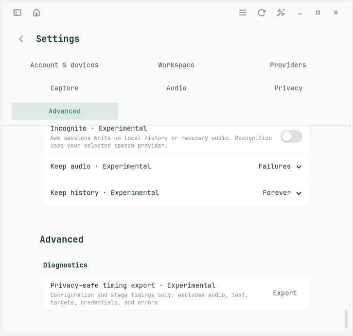
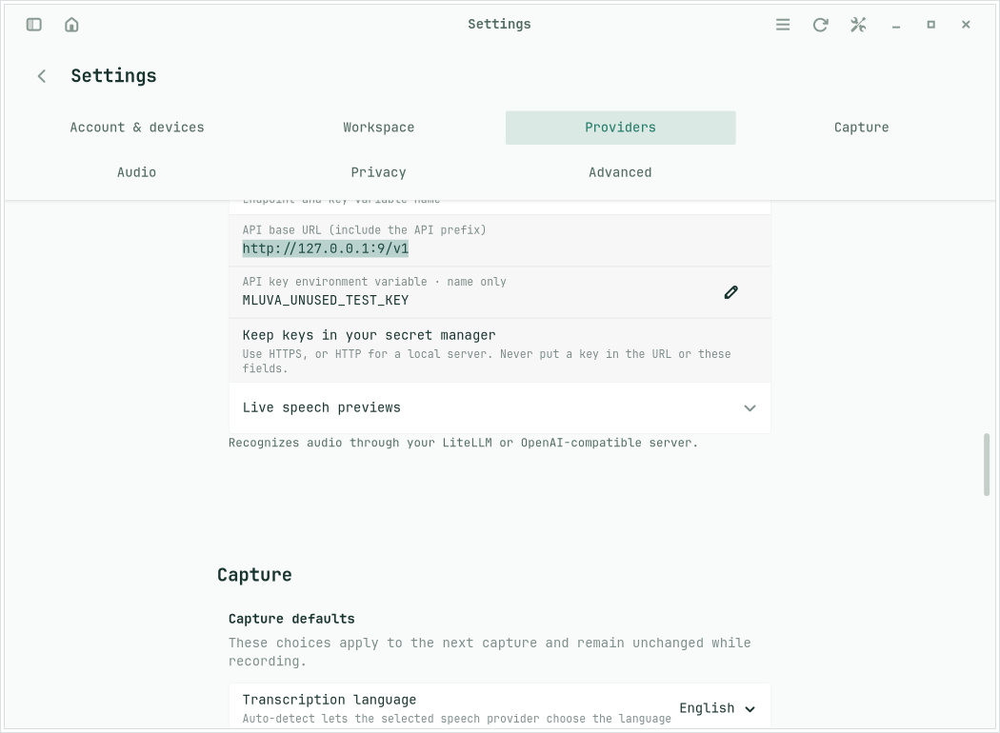

# Continuous Settings acceptance

`make linux-settings-test` exercises the real GTK application in three independent private sessions at 420×520, 736×700 and 1060×780. The 20 October 2026 run passed on GTK 4.22.4 / Libadwaita 1.9.3, using synthetic configuration and no external provider.

The check verifies Account & devices first, all seven sections remaining mapped, one outer scroll range with no independent page scrolling, section-button clicks, keyboard activation and onward focus, selection following manual scrolling, command search expanding and focusing the existing endpoint row, persisted language changes, provider unmapping on Back and reopening Account. The informational Feature maturity page is absent.

The layout retains the real `AdwPreferencesPage` widgets and their rows, makes each page's internal scroll container fit its content, and lets the outer viewport scroll. This uses the installed Libadwaita page layout; the acceptance check guards against future internal-layout changes. The run establishes isolated X11 application behavior, not physical microphones, live Wayland input or another distribution's GTK version.

The screenshots below use the same passing run. Raw runner logs and all nine images remain under the checkout's `tmp/application/run.5o5sPh/`; repeat the command for fresh evidence.

| Minimum: Account first | Narrow: continuous page end | Wide: command-search focus |
| --- | --- | --- |
|  |  |  |
