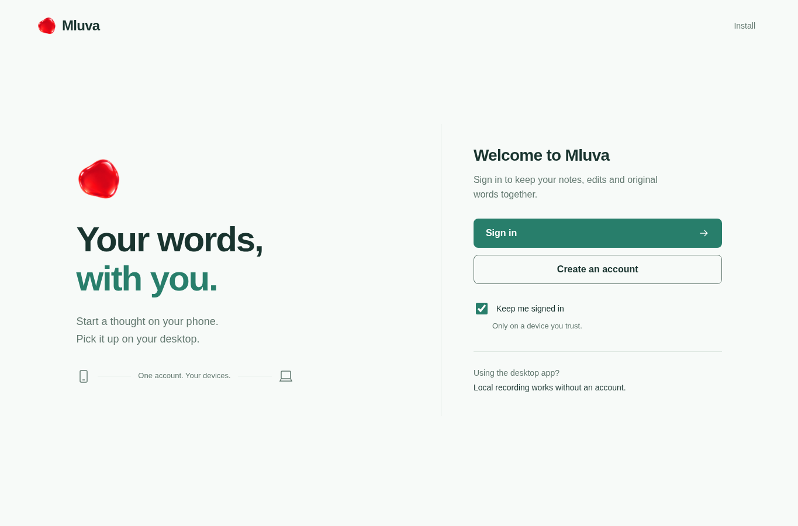
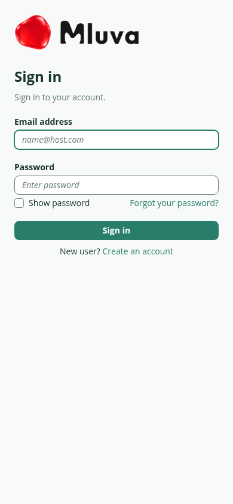

# Sign-in redesign verification

Verified on Lenovo on 13 October 2026, from `feat/mluva-signin-design` based on main `1cd91a2b4801699986ee7d04cd4f4f22c968bc93`. The sign-in redesign is prepared for review; production still uses classic Cognito login. The installed native app was rebuilt from this main commit, installed and restarted in background mode. Its release version remains 2.3.0; the [binary receipt](native-install.json) identifies the newer source precisely.

## Screens

The real credential form now carries the existing Mluva wordmark, native green palette and matching light/dark backgrounds. The entry page removes the oversized mono heading and three marketing columns, separates sign-in from account creation, and explains the local-account boundary. The callback and offline states provide a readable path back to sign-in.

| Surface | Laptop | Phone |
| --- | --- | --- |
| Welcome, light | [1365 × 900](screenshots/welcome-laptop-light.png) | [390 × 844](screenshots/welcome-phone-light.png) |
| Welcome, dark | [1365 × 900](screenshots/welcome-laptop-dark.png) | [390 × 844](screenshots/welcome-phone-dark.png) |
| Real Cognito credentials, light | [1365 × 900](screenshots/credentials-laptop-light.png) | [390 × 844](screenshots/credentials-phone-light.png) |
| Real Cognito credentials, dark | [1365 × 900](screenshots/credentials-laptop-dark.png) | [390 × 844](screenshots/credentials-phone-dark.png) |
| Sign-up / password recovery | Same managed form | [Sign-up](screenshots/signup-phone.png) · [Recovery](screenshots/recovery-phone.png) |
| Failure and retry | Same callback component | [Invalid callback, 320 px](screenshots/callback-error-320.png) · [Offline, 320 px](screenshots/offline-320.png) |

The [previous welcome](../account-sync/screenshots/welcome-phone.png) is retained in the original account-sync evidence. Screenshots above come from the real application and a temporary AWS Cognito domain, with no browser-injected styling of the credential form.

## Verification

| Check | Result and scope |
| --- | --- |
| `cd hosted && npm run check && npm test` | Pass: JavaScript/static configuration checks and 20 tests, including account-creation PKCE/state and the existing privacy/concurrency suite |
| `cd hosted && npm run test:browser` | Pass: 13 workflow checks; synthetic recording, shared originals/edits/rewrites, recovery, revocation and sign-out |
| `uv run --no-project hosted/scripts/test-login.py --run` | Pass: temporary classic-domain → managed-v2 migration, real email/password/S256 PKCE callback, named-device onboarding against the local API peer, session-only storage, native `mluva://account` code exchange/revocation and real logout |
| Responsive and failure checks in that test | Light/dark laptop and phone; 320 px no horizontal overflow; visible offline error and usable retry; invalid callback; 200% application text scaling at 640 px; reduced-motion callback; keyboard focus |
| Cloud verification cleanup | Pass: [receipt](temporary-resources.json) verifies the temporary domain/pool/client/user/branding were removed; all preliminary test pools were also removed |
| `make linux-account-test` | Pass: real private GTK process plus two browser peers; native sign-in, live text and history continuity |
| Native build / staged installation / installed runtime | Pass: optimized bundle, transaction into disposable prefix, private GTK window and D-Bus actions, clean Quit; installed binary matches that bundle and runs in background mode |
| Omarchy widget | Current 2.3.0 bundle already byte-identical to main; ownership preflight passes. Both existing private bridge services remain active |
| Ruff | Both new Python helpers format and lint cleanly |
| CloudFormation/SAM | Basic SAM validation passes. Strict SAM lint exits nonzero on two existing W1030 warnings for the optional empty certificate and rewrite-model ARNs. Running it against unchanged main reproduces the same warnings |

The [browser receipt](browser-receipt.json) contains checks and rendered control metrics. The [branding receipt](branding.json) records the applied source hashes. Reproduction and exact deployment/rollback steps are in the [branding guide](../../../hosted/branding/README.md). The cloud test requires explicit `--run`; normal unit/browser checks use local peers only. The original main-native gate remains applicable because no Rust or widget source changed; the build, installed package and changed account boundary were exercised again. GitHub's workflow is manual; no paid hosted runner was requested.

## Impeccable audit

**Implementation integrity: pass.** The existing Mluva/native colors and brand assets remain the visual authority. The screen presents a single account-entry task with a clear primary action, explicit persistence choice and useful recovery. Password fields remain on Cognito. No added product dependencies, marketing claims about unavailable cloud speech, token logging or automatic history import were introduced.

| Dimension | Score / 4 | Evidence |
| --- | --- | --- |
| Accessibility | 3 | Semantic controls/labels, visible keyboard focus, alert/status output, reduced motion; no screen-reader or physical phone acceptance claim |
| Performance | 3 | Scoped CSS, system UI font, existing logo assets, no new runtime dependency or layout animation; no field performance measurement |
| Theming | 4 | Application tokens and matching managed light/dark palette verified in rendered states |
| Responsive design | 3 | 320/390/1365 px layouts and doubled app text verified; provider controls remain smaller than the 44 px target |
| Implementation integrity | 4 | Real auth/recovery flow, existing native identity and common callback contracts |
| **Total** | **17 / 20** | **Good; provider control sizing is the principal remaining limitation** |

The manual detector ran on `index.html`, `signin.css` and `callback.html`. Its 14 primary findings belong to the existing hidden workspace/configuration markup: eight 11 px text findings, five 10 px functional-label findings and the unconfigured-host “HOSTED COMPANION” eyebrow. Its six shadow/border advisories refer to existing dialogs. These are outside the sign-in state, which renders 16 px primary body/action text and 13–14 px supporting text. They are recorded as existing issues, not silently waived or represented as a clean whole-application audit. The new scoped CSS/callback had no detector findings. One visual defect, the callback retry link inheriting browser blue, was fixed and confirmed in the final capture.

Measured palette contrast on the normal backgrounds: light body 12.70:1, light secondary text 4.51:1, light primary button 4.90:1; dark body 15.59:1, dark secondary text 6.77:1, dark primary button 8.79:1. The app's primary actions are 50 px high. Cognito's managed form uses 14 px text and 32 px input/button controls even at regular spacing.

**P2 — managed form target size.** The provider-owned credential, sign-up and recovery controls are below the preferred 44 px touch height. Current branding settings expose density/colors/radii, not arbitrary CSS or per-control height. This is a platform limit of the retained secure managed form; physical touch and browser zoom remain unverified. Reassess with a future Cognito branding capability change. It does not prevent completing sign-in.

This is Chromium viewport and keyboard verification, not proof of Safari, a physical Android/iPhone keyboard, passkeys/MFA, a screen reader, Wayland shortcuts or live-desktop permission behavior. No microphone was opened by automation. Public server transcription and rewriting remain disabled, and the private phone bridge was not retired.
