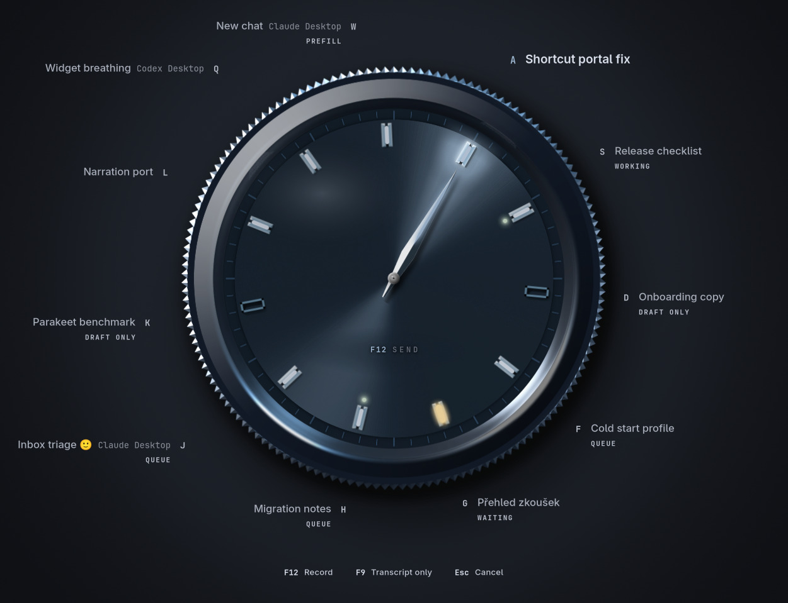
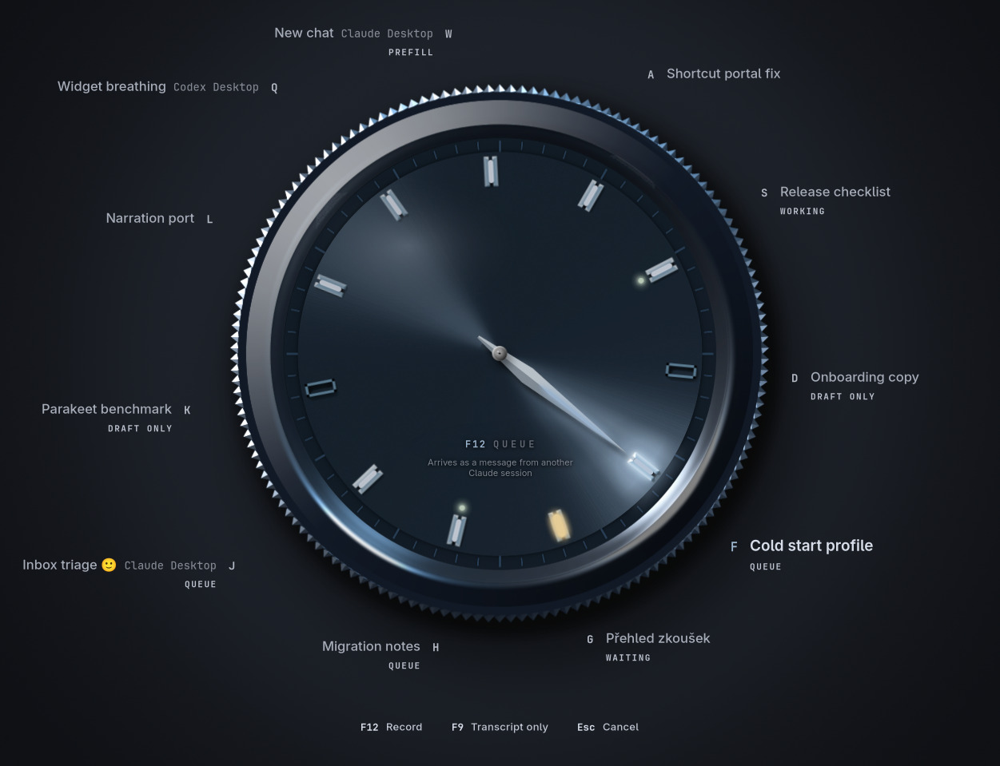
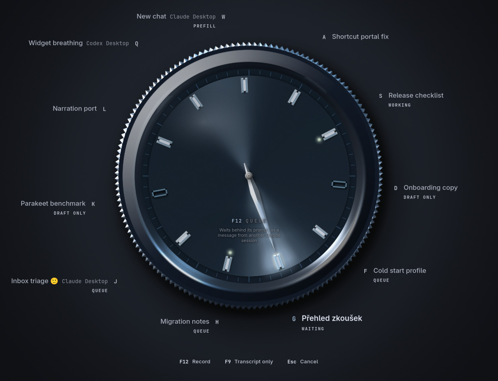
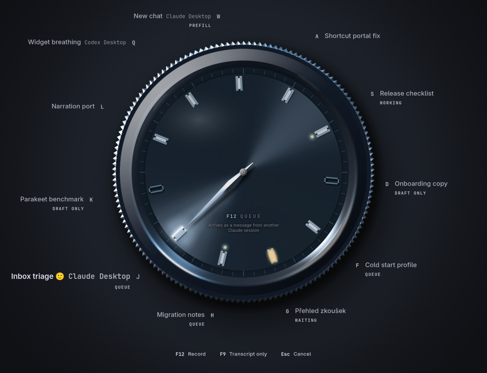
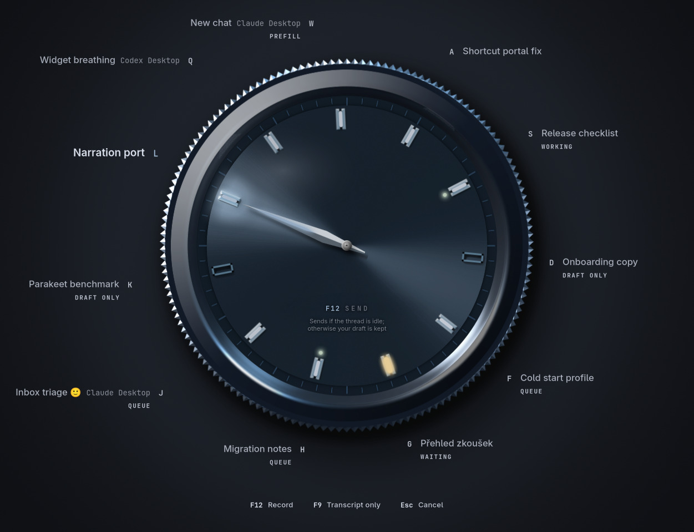
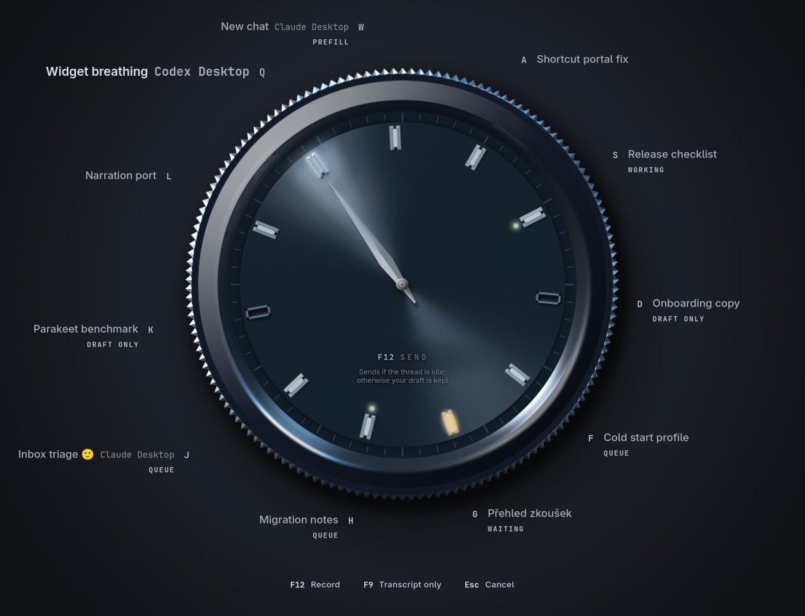
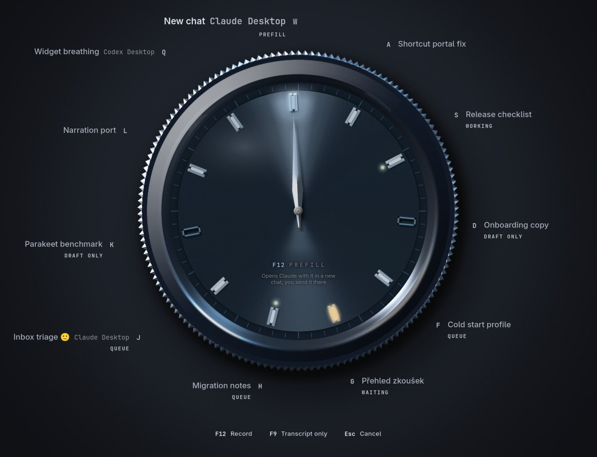
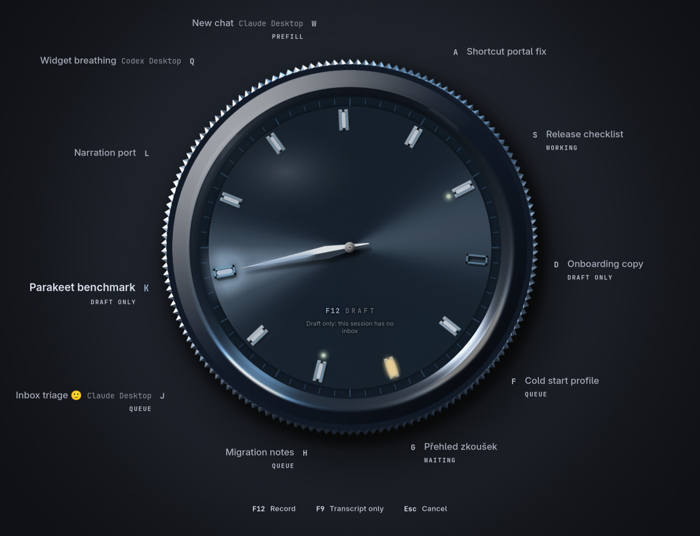

# Universal agent routing acceptance

Agent dictation now reaches Claude Code and Codex wherever they run, not only through Herdr. Every session is one target: an identity, a product (Claude Code, Claude Desktop, Codex CLI, Codex Desktop), a name, a state and a delivery level its route has been verified to reach. The wheel, the routing owner, the command line, History and diagnostics read only that model; Herdr is one transport among four. The [user guide](../../agent-routing.md) describes the behaviour.

## Per target

| Target | Discover | Name | State | Delivery | Verified how |
| --- | --- | --- | --- | --- | --- |
| Claude Code or Codex in a Herdr pane Herdr guards | Herdr `agent.guarded_list` | Agent's own title, as before | Herdr | **Send** (guarded prompt, receipt) | Unchanged tests and the real-application test with a Herdr peer |
| Claude Code in a plain terminal | `sessions/<pid>.json` in Claude Code's registry | Registry name, then transcript titles | Registry `status` | **Queue** (inbox) | Synthetic inbox peer; Mluva's transport against a disposable real Claude Code 2.1.310 session |
| Claude Code in tmux | Registry, with its `tmux` pane | As above | Registry | **Queue** (inbox); tmux typing is never used | Same transport; the disposable session ran in a private tmux server |
| Claude Code in a Herdr pane Herdr does not guard | Herdr `agent.list` joined to the registry by session ID | As above | Herdr | **Queue** (inbox) | Model and merge tests; injection inside a real Herdr pane not exercised |
| Claude Code in the background (`--bg`) | Registry `kind: "bg"` | Registry name | Registry | **Queue** (inbox) | Registry tests; the researcher's real probe |
| Claude Desktop Code session | Registry `entrypoint: "claude-desktop"` | Registry and transcript titles | Registry | **Queue** (inbox), labelled Claude Desktop | Registry tests; a replica of Desktop's spawn in research; Desktop itself not run |
| Claude Desktop new chat | Claude Desktop's user data and `claude://` handler | "New chat" | None | **Prefill** (`claude://claude.ai/new?q=`), raises Desktop | Link encoding, length limit and opener tests with a recording opener; Desktop not run |
| Codex TUI, any terminal, tmux or Herdr pane | Held `thread-writer-locks/<thread>.lock` (`/proc/locks`), read once from an app server | Codex session index | Owning server, else Herdr, else unknown | **Send if idle** (Codex queue, confirmed by client ID) | Synthetic app-server peer; fixture Codex daemon in the real-application test; real `codex app-server` as Mluva's helper |
| Codex Desktop thread | As above; holder is Desktop's bundled app server | As above | Unknown from outside | **Send if idle** | Same code path; Desktop pickup not exercised |
| Anything else | As found | As found | As found | **Draft only** | Model tests and the real-application test |

## The wheel

Production renderer, `session_wheel_gallery`, window fallback at 1920×1200 on a private Xvfb display with private HOME/XDG, D-Bus and accessibility. Every name, pane, socket, process, thread and session ID is a fixture; [`index.json`](index.json) lists each capture's targets with product, place, state, route and delivery.

| Send through Herdr | Queue to Claude Code in tmux |
| --- | --- |
|  |  |
| **Queue behind a waiting prompt** | **Queue to a Claude Desktop Code session** |
|  |  |
| **Send to an idle Codex thread** | **Send to a Codex Desktop thread** |
|  |  |
| **Prefill a new Claude chat** | **Draft only** |
|  |  |

The gallery fails on its own if a name leaves the screen, two names overlap, or status changes and a new choice move any name; it passed in Nord, default dark and default light. The lossless PNG captures of all states in all three palettes, with their fixture indexes, are kept as review evidence outside the repository.

## Evidence

| Boundary | Evidence |
| --- | --- |
| Target model | `mluva-core` tests `agent_target` and `agent_voice`: kinds keep Herdr's names and tolerate unknown ones; delivery levels and History outcomes; route priority (guarded Herdr, then inbox, then Codex queue, then a new chat); a replaced guard, epoch, pane or socket, a resumed process or a cleared session never matches a remembered choice; a new chat has its own identity; queued, taken, held and busy outcomes are never replayed; text longer than a route carries stays a draft; choices saved before targets load unchanged and an older Mluva can read new ones. |
| Claude Code inbox | `claude_inbox` tests with a synthetic registry, transcript and a Unix-socket peer: the exact minimal frame (`type`, `message`, `session_id`, `uuid`); idle sessions taken at once; a working session queued and later seen taking it; a held notice; no receipt is unconfirmed and never resent; a replaced session (`/clear`), a reused PID, a moved or removed inbox, a missing listener, a socket outside Claude Code's inbox directories, a shared directory, a symlinked socket and a socket answered by another process are all refused before anything is written; a write that fails after its first byte is unconfirmed. |
| Real Claude Code | Mluva's own transport, with production limits, against a disposable Claude Code 2.1.310 session in a private tmux server: idle, `Taken` (the agent answered, once); after `/clear` in that session, a delivery for the old choice `Rejected` with nothing shown; while a `sleep 20` tool ran, `Accepted` (queued), then taken at the next tool boundary about 22 s later, the tool uninterrupted. The session, its transcript folder and its registry entry are gone. |
| Claude Desktop new chat | `claude_desktop` tests with a recording opener: the link is percent-encoded whole (Czech, emoji, `&`, `#`, `+`, newlines); opened once; a failed opener is unconfirmed and a missing one rejected; 14,336 characters open and 14,337 do not; text too long for one command-line argument, empty text, another target and a cancelled start never open anything. |
| Codex queue | `codex` tests with a local app-server peer speaking the captured JSON-RPC over WebSocket on a Unix socket: an idle thread confirmed by its own turn's client ID (a UUIDv7); a busy thread withdrawn and nothing left queued; a message taken during withdrawal confirmed by its turn; a server without the experimental queue and an unknown thread store nothing; a lost answer settled by client ID and never queued again; a thread no longer open or held by another process refused before connecting; closing mid-wait withdraws. Only `initialize`, `initialized`, `thread/queue/list`, `thread/queue/add`, `thread/queue/delete` and `thread/turns/list` are called, and the peer's own approval request is never answered. |
| Codex discovery | Held locks only, through the kernel's lock table and the lock directory's mount (btrfs subvolumes report another device than `/proc/locks`); a lock left behind, a symlink, the coordination lock and a shared lock directory are ignored; title helpers, sub-agents and threads not started by a person are left out; state comes only from a server that has the thread loaded; a Herdr Codex pane gains the queue route by thread ID; a thread reopened by another process is a new choice. |
| Codex app server | The daemon is used only when its PID file names a live process from this boot and its control socket is private. Mluva's helper is the real `codex app-server` 0.160.1, started in a private `CODEX_HOME` whose `config.toml` has a person's real keys (approval policy `never`, `danger-full-access`, project trust tables, hooks state; synthetic values): it answered Mluva's calls, the configuration stayed byte-identical and the fingerprint guard saw no change. Reading Codex's source showed why research once saw a trust entry appear: `thread/start` under full access records the project as trusted, and Mluva never starts a thread. |
| Real application | `make linux-agent-voice-test` drives the production desktop graph with private PCM, speech, Herdr, Claude Code inbox and Codex daemon peers: the Herdr journeys as before; a Claude Code session with an inbox offered as Queue, recorded, delivered after the full countdown as one frame and recorded in History as `delivered`; a live Codex thread offered as Send, sent if idle and recorded `sent`; the same thread busy, withdrawn, recorded `busy`, with Send draft offered and the status saying it was busy. Diagnostics carry `queued-agent`, `route-queue-taken` and `route-draft-busy` and no text or title. |
| Routing CLI | `dev/verify.sh session … linux/tests/support/herdr_cli.sh` with the production process: list, status, select, ambiguity and blocked rejection, restart and Incognito, and `mluva agents list` reporting `route` and `delivery`. |

## Not verified

- Claude Desktop itself: how it shows a queued peer turn, and the `new?q=` prefill (both need a signed-in Desktop on the live desktop).
- Codex Desktop picking up a queued message (code-level only; a thread its server does not take fails safe to a kept draft).
- Injection into a session inside a real Herdr pane, Claude Code or Codex.
- macOS: every platform seam answers "unavailable" there until verified; no delivery was made on a Mac.
- Physical keys, the live Wayland overlay and a real microphone, as before.

These checks ran in a disposable X11 desktop with private HOME/XDG, D-Bus, accessibility, clipboard, audio fixtures and loopback providers, except the real Claude Code and real `codex app-server` checks, which ran against disposable sessions and a private `CODEX_HOME`.
